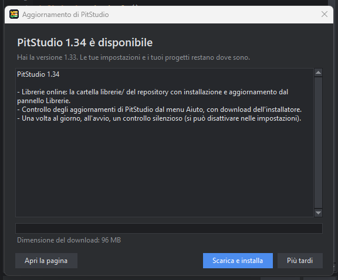
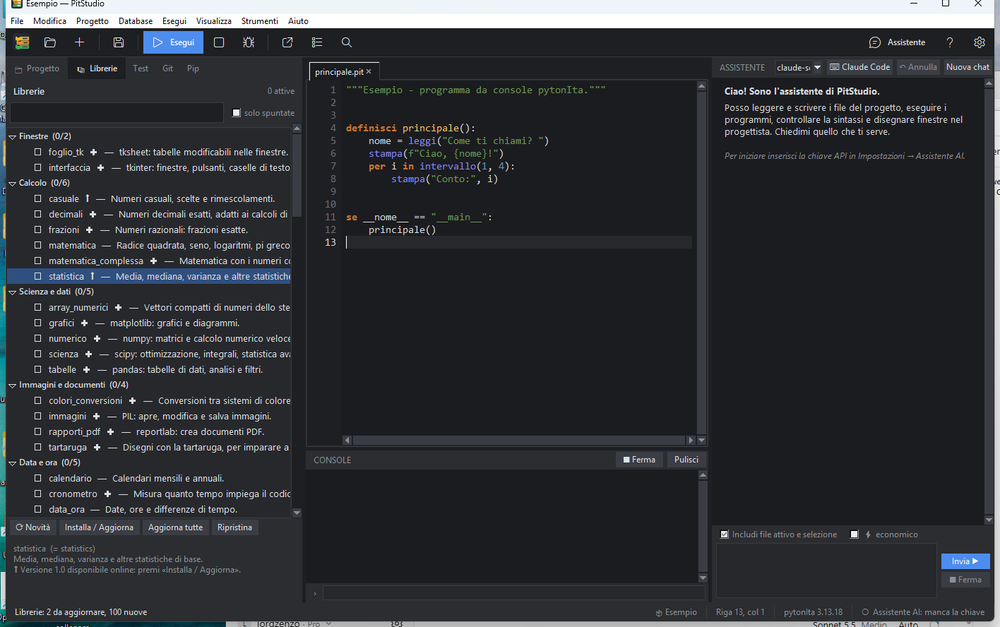

# Aggiornamenti e librerie online

PitStudio e le librerie italiane vengono dal repository pubblico di pytonIta su GitHub. Da qui puoi sapere se c'è qualcosa di nuovo e scaricarlo, senza cercare niente a mano.

## Aggiornare PitStudio

Scegli **Aiuto → Controlla aggiornamenti…**. PitStudio legge l'ultima *Release* del repository e confronta il numero di versione con il tuo.

- Se c'è una versione più nuova vedi le **novità** e il pulsante **Scarica e installa**: scarica il programma di installazione (con la barra di avanzamento), poi ti chiede se chiudere PitStudio e avviarlo. Prima di chiudere ti chiede di salvare i file modificati; se annulli, l'installatore resta scaricato e ti dice dove.
- **Apri la pagina** apre la Release nel browser, se preferisci scaricare a mano.
- Le impostazioni (`~\.rad`) e i tuoi progetti non vengono toccati.

Il file viene scaricato solo da `github.com` (https) e, quando la Release ne indica l'impronta SHA-256, viene verificata prima di avviarlo.

**Controllo automatico.** Una volta al giorno, poco dopo l'avvio, PitStudio fa un controllo silenzioso: se c'è una versione nuova lo scrive nella barra di stato, altrimenti non dice niente. Si disattiva in *Strumenti → Impostazioni → Aggiornamenti*. Con il controllo disattivato PitStudio non contatta mai GitHub da solo.

## Le librerie online

Le librerie italiane arrivano già nell'installatore. Nel repository, nella cartella **`librerie/`**, ce n'è una copia con un elenco (`indice.json`): serve per avere le versioni più recenti e quelle nuove senza reinstallare tutto.

Nel pannello **Librerie** ci sono quattro pulsanti sotto l'elenco:

| Pulsante | Cosa fa |
|---|---|
| **⟳ Novità** | legge l'elenco online e confronta ogni libreria con quella che hai |
| **Installa / Aggiorna** | scarica la libreria selezionata |
| **Aggiorna tutte** | aggiorna tutte quelle con ⬆ (chiede conferma) |
| **Ripristina** | toglie la copia scaricata e torna a quella inclusa |

Nell'elenco: **⬆** vuol dire che online c'è una versione diversa dalla tua, **✚** che la libreria è nuova e non l'hai ancora.

### Dove finiscono

Le librerie scaricate vanno in `~\.rad\librerie`. Il runtime di pitonit cerca **prima** quella cartella e poi la sua `Lib`, quindi una copia scaricata vince su quella inclusa. «Ripristina» la cancella e tutto torna come prima. Non servono permessi di amministratore e non si modifica l'installazione.

I programmi vedono subito le librerie scaricate; per averne i **suggerimenti** nell'editor, le librerie *nuove* richiedono il riavvio di PitStudio.

### Sicurezza

Ogni file è controllato con la sua impronta SHA-256 dell'indice prima di essere scritto: se non corrisponde, non viene installato. Una libreria è un insieme di file `.py` e viene scaricata **intera** (un pacchetto a metà nasconderebbe quello completo). I percorsi che uscirebbero dalla cartella vengono scartati.

### Scrivere una libreria per la zona `librerie/`

Chi vuole aggiungere una libreria al repository trova le istruzioni in `librerie/LEGGIMI.md` del repository.
