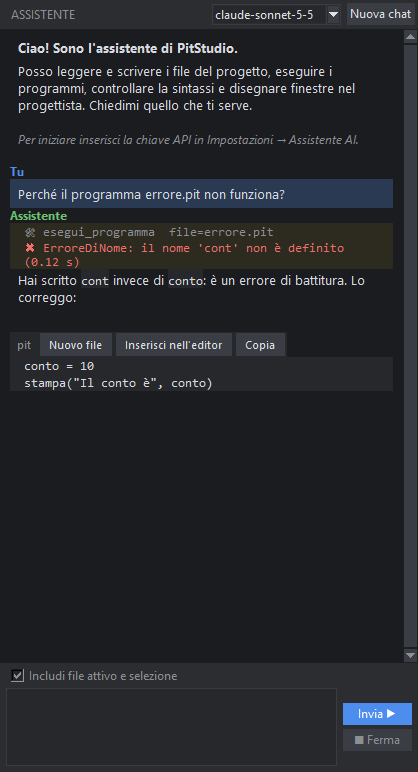
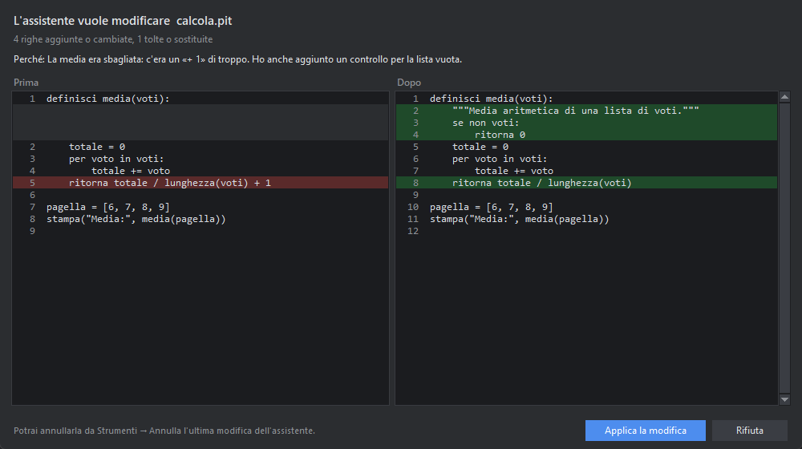

# L'assistente AI

L'assistente è **Claude** (oppure **Gemini** o **DeepSeek**, a scelta) e lavora dentro PitStudio: non solo ti risponde, ma può **usare l'ambiente** al posto tuo, sul progetto aperto.

## Configurazione (una volta sola)

1. Apri *Strumenti → Impostazioni → Assistente AI*.
2. Scegli il **fornitore** (Claude, Gemini o DeepSeek; Claude è il predefinito e di solito il più bravo a programmare) e incolla la sua **chiave API** (la chiave resta nel tuo computer, nel file `~\.rad\config.json`). In alternativa imposta la variabile d'ambiente: `ANTHROPIC_API_KEY`, `GEMINI_API_KEY` o `DEEPSEEK_API_KEY`.
3. Scegli il **modello** del fornitore (anche dal menu in alto nella chat) e le **conferme** (vedi sotto). Premi OK.

La barra di stato in basso mostra «● Assistente AI pronto» quando la chiave c'è.

## Usare la chat

Apri la chat con **Ctrl+J** (o il pulsante *Assistente*). Scrivi la richiesta e premi **Invio** (**Maiusc+Invio** va a capo). L'assistente risponde nella cronologia;
quando usa l'ambiente lo vedi in riga: 🛠 nome dello strumento, ✔ o ✖ con l'esito.

- Con **Includi file attivo e selezione** (predefinito) l'assistente sa quale file hai aperto, a che riga sei e cosa hai selezionato.
- I blocchi di codice nelle risposte hanno i pulsanti **Copia**, **Inserisci nell'editor** e **Nuovo file**.
- **■ Ferma** interrompe il lavoro in corso; **Nuova chat** ricomincia da zero. La conversazione di ogni progetto è salvata in `<progetto>\.rad\chat.json`.

## Cosa può fare

| Strumento | Cosa fa |
|---|---|
| `stato_ide` | vede progetto, schede aperte, file attivo, selezione e le ultime righe della console |
| `elenca_file`, `leggi_file`, `cerca_nel_progetto` | esplora il progetto (legge anche le modifiche non ancora salvate) |
| `scrivi_file`, `modifica_file` | crea o modifica file (sostituzioni precise) |
| `controlla_sintassi` | verifica il codice in italiano |
| `esegui_programma` | esegue un file e legge output ed errori |
| `apri_file`, `elimina_file` | apre un file nell'editor; elimina (chiede sempre conferma) |
| `ottieni_form`, `imposta_form` | legge e **disegna finestre** nel progettista |
| `tipi_mattonelle`, `ottieni_mattonelle`, `imposta_mattonelle` | costruisce **programmi a mattonelle** |
| `converti_in_mattonelle` | converte un `.pit` in mattonelle |
| `membri_modulo` | scopre i nomi delle librerie in italiano |

## Esempi di richieste

- *«Spiegami questo codice»* (con del codice selezionato).
- *«Trova perché l'ultima esecuzione dà errore e correggilo»*, oppure *Strumenti → Chiedi all'AI di correggere l'ultimo errore*.
- *«Crea una finestra con un campo di testo, un pulsante "Calcola" e un'etichetta per il risultato; il pulsante deve raddoppiare il numero»*.
- *«Aggiungi il salvataggio dei dati in un file JSON»*.
- *«Costruisci a mattonelle un programma che stampa la tabellina del 7»*.
- *«Converti `vecchio.pit` in mattonelle e dimmi cosa è rimasto come testo»*.

## Codice sempre controllato

Prima di scrivere un file `.pit` o `.py`, PitStudio ne controlla la **sintassi**. Se il codice dell'assistente ha un errore, **tu non lo vedi nemmeno**: l'errore torna all'assistente, che corregge e riprova (fino a 2 correzioni automatiche). Se non ci riesce, ti chiede se salvare comunque il file per correggerlo a mano. Il file non viene toccato finché il codice non è valido o non lo decidi tu.

## Quanto costa

L'assistente usa la tua chiave API e i costi dipendono dal modello e dal testo scambiato. Per tenerli bassi:

- la **conversazione già letta viene riusata** (cache dell'API): a ogni passo si paga solo ciò che è nuovo;
- l'assistente legge solo le parti di file che servono e modifica poche righe invece di riscrivere tutto;
- in basso nella chat vedi i token della conversazione, con quanti letti dalla cache, e una **stima in dollari** (≈ $0.03);
- con *Strumenti → Statistiche dell'assistente* vedi, per il progetto: richieste, token, quanti file erano **validi al primo tentativo**, quanti corretti da solo, quanti programmi eseguiti con successo, e il **costo stimato** (totale, per richiesta, per modello, la richiesta più cara). I dati restano sul tuo computer (`.rad\ai_registro.jsonl`) e si disattivano nelle impostazioni.
- spuntando **⚡ economico** (sotto la chat) la richiesta usa il **modello economico** (impostazione *ai.modello_economico*, predefinito Haiku): ideale per spiegazioni e piccole correzioni. *Strumenti → Chiedi all'AI di spiegare* lo usa già da solo;
- nelle **conversazioni lunghe** (oltre circa 30 000 token stimati) i vecchi risultati degli strumenti e i testi dei file già scritti vengono accorciati, e nella chat compare un avviso. Si regola o si spegne (0) nelle impostazioni.

## Vedi cosa cambia, e puoi annullare

Quando l'assistente vuole scrivere un file, PitStudio ti mostra la finestra **prima / dopo**: a sinistra il file com'è, a destra come diventerebbe, con le righe tolte in rosso e quelle aggiunte in verde (le parti invariate lunghe sono nascoste). In alto leggi **«Perché»**: la spiegazione che l'assistente ha dato un attimo prima. Scegli *Applica la modifica* oppure *Rifiuta*.

Tutto ciò che l'assistente cambia in una richiesta (file modificati, creati, eliminati, finestre disegnate) forma un **gruppo che si annulla in un colpo solo**:

- il pulsante **↶ Annulla** in alto nella chat, o *Strumenti → Annulla l'ultima modifica dell'assistente*: i file tornano come erano, quelli creati vengono tolti, quelli eliminati ricompaiono;
- *Strumenti → Cronologia delle modifiche dell'assistente…* mostra le ultime 50 richieste con i file toccati (✎ modificato, ＋ creato, ✖ eliminato) e permette di annullare anche quelle più vecchie. Il simbolo ⚠ avvisa se un file è stato cambiato anche dopo l'assistente: annullando perderesti anche quei ritocchi.

Le copie stanno nel progetto (cartella `.rad/storia`), senza bisogno di git. Si salvano i file di testo (codice, JSON, Markdown…) fino a 512 KB: immagini e altri file binari non sono coperti. Si disattiva con l'impostazione *ai.storia*.

## Programmi sotto controllo

I programmi che l'assistente esegue hanno un **limite di memoria** (1024 MB predefiniti) e un massimo di **20 processi**, oltre al tempo massimo: un programma sbagliato che riempie la memoria o si moltiplica viene fermato dal sistema senza bloccare il computer. Gli stessi limiti si possono mettere ai tuoi programmi dalle impostazioni (*Esecuzione*, 0 = nessun limite). Alla chiusura di PitStudio i programmi ancora in corso vengono terminati.

## Senza crediti API: Claude Code

Se hai un abbonamento a Claude ma non crediti per l'API, puoi usare **Claude Code** dentro il progetto: vedi [Claude Code con l'abbonamento](#claude-code).

## Sicurezza e privacy

- **Conferme**: per default l'assistente chiede il permesso prima di **scrivere file** e prima di **eseguire programmi**; vedi un'anteprima di cosa farà. Eliminare un file chiede sempre conferma. Le conferme si regolano nelle impostazioni.
- L'assistente lavora **solo dentro la cartella del progetto**: non può leggere né scrivere fuori.
- Il contenuto che gli mostri (file letti, output dei programmi, ciò che scrivi) viene inviato al fornitore che hai scelto (Anthropic, Google o DeepSeek) per ottenere la risposta, come in qualsiasi uso dell'API. Non aprire progetti con dati riservati se non vuoi che vengano inviati.
- Puoi aggiungere **istruzioni permanenti** (per esempio «rispondi in modo molto breve») nelle impostazioni.

> **Nota:** i costi dell'API dipendono dal modello e da quanto testo viene scambiato; in basso nella chat vedi i token usati in questa conversazione.
