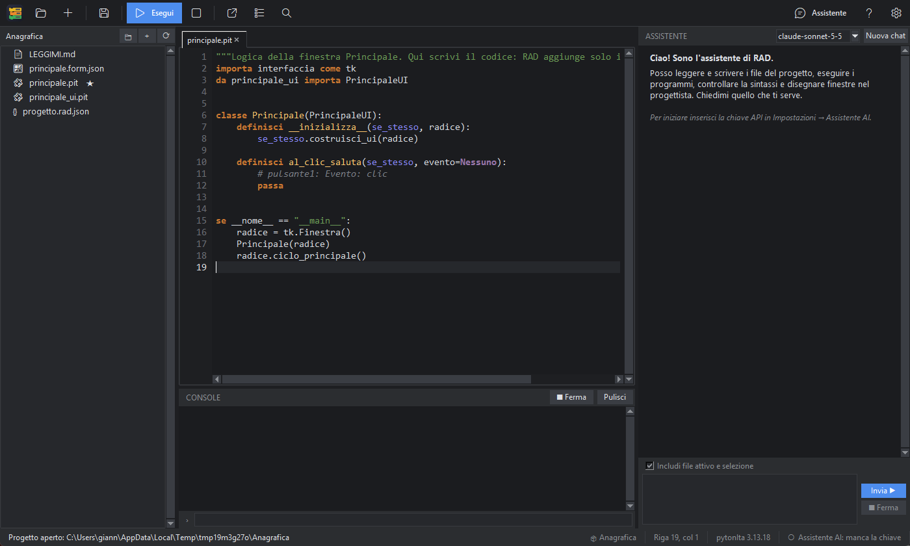

# Benvenuto in PitStudio

**PitStudio** è l'ambiente di sviluppo per **pytonIta**, il linguaggio di programmazione con parole chiave, funzioni ed errori in italiano.
Con PitStudio puoi scrivere programmi in tre modi che convivono nello stesso progetto:

- **scrivendo codice** in un editor con colori, suggerimenti in italiano e controllo degli errori mentre scrivi;
- **disegnando finestre** con il progettista grafico (trascini pulsanti, caselle di testo, elenchi… e PitStudio genera il codice);
- **a mattonelle**, incastrando blocchi colorati come in Scratch, senza scrivere una riga: il programma si trasforma in codice pytonIta vero.

In più c'è un **assistente AI** (Claude) che non si limita a rispondere: lavora *dentro* l'ambiente, legge e scrive i file del progetto,
li esegue, controlla gli errori e può persino disegnare finestre e costruire programmi a mattonelle per te.

## Da dove cominciare

1. Se è la prima volta, segui i [Primi passi](#primi-passi): in dieci minuti hai un programma che gira.
2. Per conoscere ogni parte della finestra vai a [L'interfaccia](#interfaccia).
3. Per scegliere come programmare: [Editor](#editor), [Progettista di finestre](#progettista), [Programmi a mattonelle](#mattonelle).
4. Per usare l'assistente: [Assistente AI](#assistente).
5. Se qualcosa non va: [Problemi e domande frequenti](#problemi).

> **Suggerimento:** premi **F1** in qualsiasi momento per aprire questa guida. Se il cursore è su una parola del codice (per esempio `mentre` o `lunghezza`),
> F1 apre direttamente la sua scheda nel [riferimento del linguaggio](#linguaggio).

## Cosa serve

PitStudio gira su Windows con l'interprete **pitonit** (già incluso nella cartella `pitonit`). Per l'assistente AI serve una chiave API Anthropic
(vedi [Assistente AI](#assistente)); tutto il resto funziona senza connessione e senza account.
