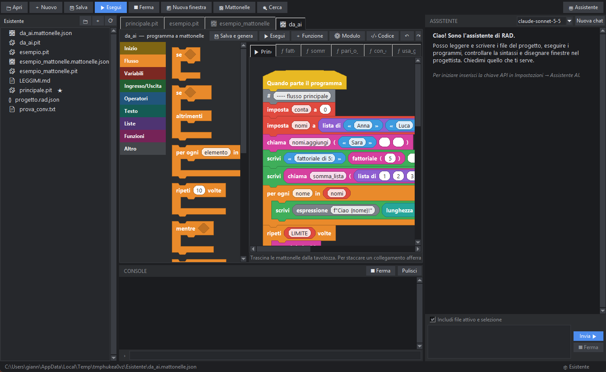

# Convertire un programma in mattonelle

La conversione inversa trasforma un file `.pit` già scritto in un programma a mattonelle, per **vederlo** e modificarlo in modo visuale.

## Come si fa

- Clic destro su un `.pit` nell'albero → **Converti in mattonelle…**, oppure *File → Converti il file corrente in mattonelle…*, oppure chiedilo all'assistente.
- Il risultato è `nome_mattonelle.mattonelle.json` più il codice rigenerato `nome_mattonelle.pit`. **L'originale non viene toccato.**
- Un rapporto dice quante funzioni e mattonelle sono state create e quali parti sono rimaste come testo.

## Cosa diventa cosa

| Nel `.pit` | Nelle mattonelle |
|---|---|
| `definisci nome(parametri)` | una finestra di lavoro per funzione (anche con valori predefiniti e `*args`) |
| il codice fuori dalle funzioni | il flusso principale (il blocco `se __nome__ == "__main__":` è assorbito) |
| `stampa`, assegnazioni, `+=`, `se`, `per`, `mentre`, `prova`, `con apri`, `ritorna`, `globale` | le mattonelle corrispondenti |
| `x.metodo(a, b)`, `funzione(a)` | *chiama* / *chiamata* |
| operazioni, confronti, `e`/`o`/`non`, indici, `leggi`, `intero`, `lunghezza`… | mattonelle-valore |
| commenti sopra un'istruzione | mattonelle «commento» |
| `classe` con i suoi metodi | una **classe** (＋ Classe) e **una pagina per ogni metodo** (`Classe.metodo`); attributi di classe e decoratori restano nella classe |
| `self.x`, `self.x = …`, `a, b = b, a`, `obj.metodo(x, colore=rosso)` | **Oggetti**: attributo, imposta (anche a più nomi), chiama su un oggetto, opzione `nome=valore`, tupla |
| `lambda`, `[x per x in …]`, `a se c altrimenti b`, `a ≤ x ≤ b`, `a è b`, `t[1:3]`, `{k: v}` | le mattonelle corrispondenti |
| importazioni, costanti | **codice di modulo** (⚙ Modulo), restano com'erano |
| tutto il resto (f-string, tuple, dizionari, espressioni condizionali…) | mattonelle di testo grigie («codice», «espressione»): fanno la stessa cosa dell'originale |

Il codice rigenerato si comporta come l'originale (PitStudio lo verifica sui propri test). I commenti a fine riga non si conservano.
