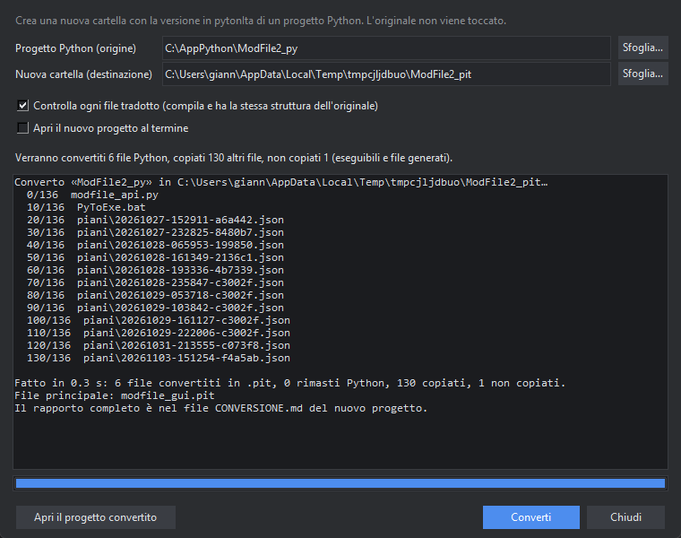

# Convertire un progetto Python in pytonIta

Hai un progetto scritto in Python (`.py`)? PitStudio ne crea una **copia in pytonIta** (`.pit`) in una nuova cartella. **L'originale non viene toccato.**

## Come si fa

- *File → Converti un progetto Python in pytonIta…* (oppure, a progetto aperto, *Progetto → Converti questo progetto Python in pytonIta…*).
- Scegli la cartella del progetto Python e la nuova cartella (viene proposta `nome_pit`). La nuova cartella non deve esistere già con dei file dentro, e non può coincidere con l'originale.
- Lascia attiva l'opzione **Controlla ogni file tradotto**, poi premi **Converti**.
- Al termine puoi aprire subito il nuovo progetto.

## Cosa succede

- Ogni `.py` diventa un `.pit` con le parole chiave in italiano (`def` → `definisci`, `if` → `se`, `import` → `importa`…), compresi i pacchetti e gli import relativi.
- Gli altri file (dati, testi, immagini, `.bat`) vengono copiati così come sono.
- Non vengono copiati: cartelle di sistema (`.git`, `__pycache__`, ambienti virtuali), file generati e gli eseguibili (`.exe`, `.dll`, `.pyd`…).
- Il file principale viene riconosciuto (quello con `if __name__ == "__main__"`) e scritto nel manifesto del nuovo progetto.

## Il controllo

Per ogni file la traduzione viene **ricompilata e confrontata con l'originale**: deve avere la stessa struttura. Un file che non supera il controllo (per esempio perché ha un errore di sintassi) **resta `.py`** nella nuova cartella, con il motivo scritto nel rapporto, e il resto del progetto si converte comunque.

## Il rapporto

Nel nuovo progetto trovi `CONVERSIONE.md`, con: i file convertiti, quelli rimasti Python e perché, i **nomi rinominati** (un nome che coincide con una parola riservata italiana prende un `_` finale), le **stringhe che nominano file `.py`** e i file non copiati.

## Cosa controllare a mano

- Le **stringhe** che citano file `.py` (per esempio `subprocess.run(["python", "main.py"])`) non vengono cambiate: vanno adeguate a `.pit` e a `pitonit`.
- I file `.bat` e gli script di avvio copiati lanciano ancora `python`.
- Gli eseguibili non sono copiati: vanno rigenerati.
- Un nome rinominato con `_` vale anche per chi usa il modulo dall'esterno.

Nella prova fatta su un progetto reale (interfaccia grafica, parte logica e test) tutti i file sono stati convertiti, i 28 test hanno dato lo stesso esito e l'interfaccia si è avviata in italiano.
