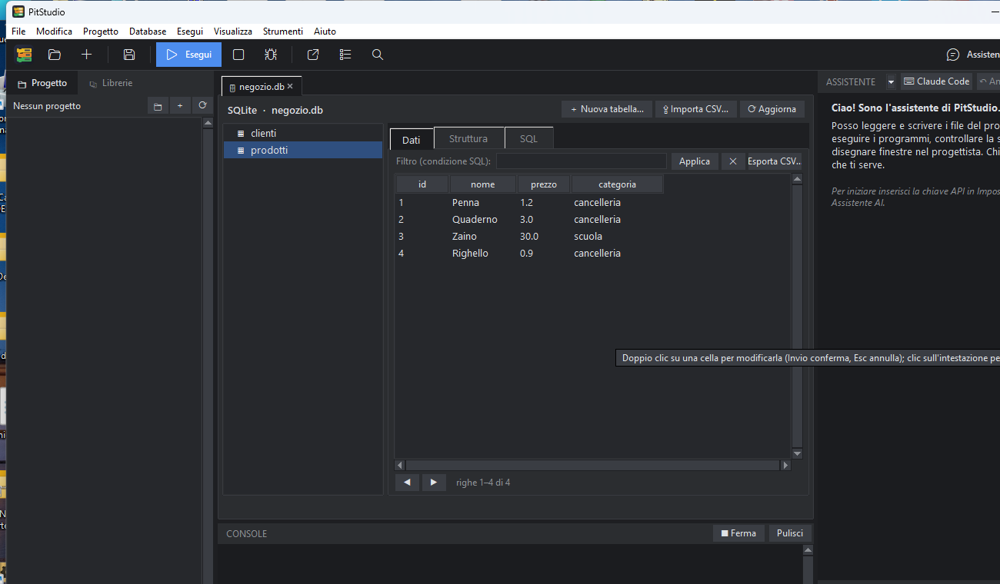

# I database: SQLite e MySQL

PitStudio ha un **gestore di database** integrato: vedi le tabelle, correggi i dati, crei tabelle senza scrivere SQL e provi i comandi SQL.



- **SQLite** è il predefinito: un database è un solo file (`.db`, `.sqlite`, `.sqlite3`) dentro il progetto. Non serve installare nulla.
- **MySQL** (e MariaDB) si usa collegandosi a un server. Serve il driver `pymysql`: PitStudio lo installa per te la prima volta.

## Aprire un database

- *Database → Nuovo database SQLite…* crea un file vuoto (nella cartella del progetto) e lo apre.
- *Database → Apri un database SQLite…*, oppure un doppio clic su un file `.db` / `.sqlite` / `.sqlite3` nell'albero del progetto.
- *Database → Collegati a MySQL…*: server, porta, utente, password e database (può restare vuoto). **La password non viene salvata.** Se manca il driver, PitStudio propone di installarlo (*Database → Installa il driver MySQL* fa la stessa cosa).

Ogni database si apre in una scheda: a sinistra le **tabelle** (▦) e le **viste** (◩), a destra tre pagine.

## Dati

- Le righe della tabella, 200 per pagina (◀ ▶).
- **Doppio clic su una cella** per cambiarla: Invio salva, Esc annulla. `NULL` (maiuscolo) vuol dire «nessun valore». Se il valore non è accettato (per esempio una colonna *Non nulla*) il database lo rifiuta e vedi il messaggio.
- **Clic sull'intestazione** per ordinare (un secondo clic inverte).
- **Filtro**: scrivi una condizione SQL, per esempio `prezzo > 5 AND nome LIKE 'P%'`, e premi Invio.
- **＋ Riga…** aggiunge una riga: i campi vuoti prendono il valore predefinito. **Elimina righe** toglie quelle selezionate (anche con il tasto Canc). **Esporta CSV…** salva le righe mostrate.
- Le viste e le tabelle senza chiave primaria non si possono modificare: lo dice la barra sotto la tabella.

## Struttura e nuova tabella

- La pagina **Struttura** elenca le colonne (tipo, chiave, obbligatoria, valore predefinito, riferimenti ad altre tabelle) e mostra l'istruzione che ha creato la tabella.
- **＋ Nuova tabella…** apre una finestra in cui scrivi il nome e descrivi ogni colonna: tipo, **PK** (chiave primaria), **Non nulla**, **Unica**, **Auto** (il numero cresce da solo) e valore predefinito. In basso vedi **l'istruzione SQL** che verrà eseguita, e si aggiorna mentre scrivi: è anche un buon modo per imparare l'SQL.
- **＋ Colonna…** aggiunge una colonna a una tabella esistente; **Elimina la tabella…** la toglie con tutti i dati (chiede conferma).
- **⇪ Importa CSV…** inserisce nella tabella scelta le righe di un file CSV (la prima riga deve contenere i nomi delle colonne).

## SQL

La pagina **SQL** è un piccolo editor: scrivi uno o più comandi separati da `;` e premi **Ctrl+Invio** (o ▶ Esegui). Se selezioni una parte del testo, esegue solo quella.

- Il risultato appare in una tabella sotto l'editor, con il numero di righe e il tempo impiegato; **Esporta CSV…** lo salva.
- Se un comando sbaglia vedi il messaggio del database, e in una serie di comandi ti dice quale è il guasto («Istruzione 2 di 3: …»).
- La **Storia** conserva i comandi eseguiti: sceglierne uno lo riscrive nell'editor.
- Mentre scrivi, la barra in basso suggerisce nomi di tabelle, colonne e parole SQL.
- Un doppio clic su una tabella a sinistra scrive un `SELECT` già pronto.
- Le modifiche (INSERT, UPDATE, DELETE, CREATE…) sono confermate subito: non c'è un «annulla».

## Usare il database nei tuoi programmi

In pytonIta il modulo `database` (cioè `sqlite3`) è già pronto:

```
importa database

conn = database.connect("dati.db")
conn.execute("CREATE TABLE IF NOT EXISTS prodotti (id INTEGER PRIMARY KEY, nome TEXT)")
conn.execute("INSERT INTO prodotti (nome) VALUES (?)", ("Penna",))
conn.commit()
per riga in conn.execute("SELECT * FROM prodotti"):
    stampa(riga)
```

Quando esporti il progetto come Python, il file `.db` viene copiato insieme al resto.
