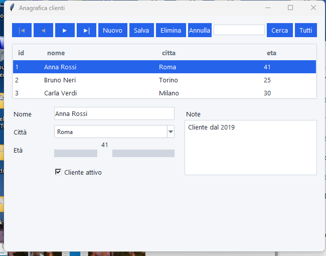
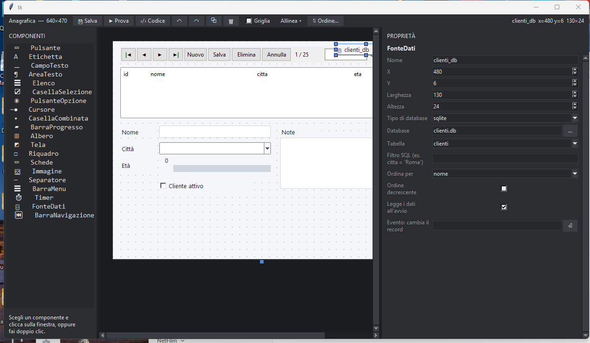

# Dati nelle finestre

Nel progettista puoi **collegare i componenti a una tabella** di un database (SQLite o MySQL) senza scrivere codice: i campi mostrano il record corrente, gli elenchi mostrano tutti i record e una **barra di navigazione** scorre, aggiunge, salva ed elimina.



## I tre ingredienti

### 1. La fonte dati (componente «FonteDati»)

Scegli **FonteDati** dalla palette: compare come una piccola etichetta gialla (nel programma non si vede). Nell'ispettore imposti:

| Proprietà | Cosa fa |
|---|---|
| **Tipo di database** | `sqlite` (un file) o `mysql` (un server) |
| **Database** | il file SQLite (il pulsante **…** lo cerca; se sta nella cartella del progetto il percorso resta relativo) oppure il nome del database MySQL |
| **Server / Porta / Utente MySQL** | compaiono solo per MySQL. La **password viene chiesta all'avvio** e non è mai scritta nei file |
| **Tabella** | un elenco con le tabelle vere del database: si aprono quando clicchi la freccia |
| **Filtro SQL** | una condizione fissa, per esempio `citta = 'Roma'` |
| **Ordina per** / **Ordine decrescente** | scegli la colonna con cui ordinare i record |
| **Salva da solo** | acceso: le modifiche ai campi si salvano da sole quando cambi record, cerchi, scrivi un record nuovo e chiudi la finestra (se il salvataggio non riesce, per esempio manca un campo obbligatorio, te lo dice e resti lì). Spento: si salva solo con «salva» della barra o con `fonte1.salva()` |
| **Legge i dati all'avvio** | se spento, la finestra parte vuota e i dati si leggono con `fonte1.apri()` |
| **Evento: cambia il record** | un gestore richiamato a ogni cambio di record |

Una finestra può avere più fonti dati (per esempio clienti e ordini).



### 2. I componenti legati ai campi

**Etichetta, Campo di testo, Area di testo, Casella di selezione, Cursore e Casella combinata** hanno due proprietà in più:

- **Fonte dati**: quale fonte usano (si sceglie tra quelle della finestra);
- **Campo della tabella**: la colonna che mostrano e modificano (un elenco con le colonne vere; puoi anche scriverla).

Il componente mostra il valore del record corrente e, quando salvi, il suo contenuto viene scritto nella tabella. Le **etichette** servono solo a mostrare (non si salvano): vanno bene per l'identificativo.

**Elenco** (con *Campo*) mostra quella colonna per tutti i record; **Albero** (solo *Fonte dati*) mostra una riga per record: appena lo colleghi prende da solo le colonne della tabella. Scegliere una riga in un elenco o in un albero porta a quel record.

### 3. La barra di navigazione (componente «BarraNavigazione»)

Una barra con i pulsanti che scegli tu, uno per uno, nell'ispettore: **primo**, **precedente**, **successivo**, **ultimo**, **nuovo**, **salva**, **elimina**, **annulla**, più la scritta «3 / 25» e, se vuoi, una **casella di ricerca** (cerca in tutte le colonne). Si collega con la proprietà *Fonte dati*. I pulsanti si spengono quando non servono (per esempio «successivo» sull'ultimo record); mentre scrivi un record nuovo, «primo», «precedente» e «ultimo» riportano ai record salvati.

## Cosa controlla da solo

- Un campo **obbligatorio** (NOT NULL senza valore predefinito) deve essere compilato.
- Un campo **numerico** deve contenere un numero (la virgola va bene: `2,5`).
- Le colonne che il database riempie da solo (chiave con auto-incremento) si lasciano vuote.
- Se manca la tabella o il database, la finestra si apre lo stesso e dice cosa non va.
- Nell'ispettore, le avvertenze segnalano i componenti con una fonte che non esiste o senza campo.

## Nel codice

La finestra generata crea `se_stesso.fonte1` (un oggetto `Collegamento` di `fonte_dati.pit`, che PitStudio copia nel progetto):

```
dati = se_stesso.fonte1
dati.corrente()                # il record corrente: {"nome": "Anna", "citta": "Roma"}
dati.valore("citta")           # un solo campo
dati.numero_record()           # quanti record
dati.successivo()              # primo, precedente, successivo, ultimo, nuovo, salva, elimina, annulla, vai(3)
dati.cerca("roma")             # filtra (testo vuoto = tutti)
```

## Maschera automatica

*Database → Crea una maschera dalla tabella…* costruisce una finestra che usa questi stessi componenti (una fonte, la barra con ricerca, un albero e un campo per colonna): la modifichi poi nel progettista come ogni altra finestra.

Funziona anche dopo **Esporta come Python** e **Crea l'eseguibile**: il database SQLite del progetto viene copiato insieme al resto.
