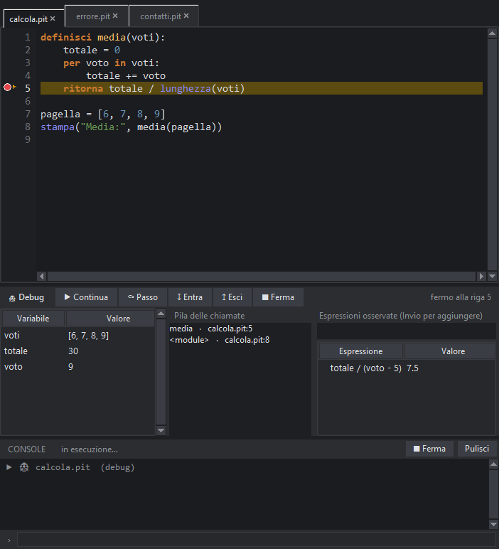

# Il debugger

Il debugger esegue il programma sotto il tuo controllo: lo **fermi** dove vuoi, **guardi** le variabili e **avanzi** una riga alla volta. È lo strumento giusto quando il programma parte ma fa qualcosa di sbagliato. Una spiegazione con un esempio è nella [lezione 12](#lezione-12).

## Punti di arresto

- **Clic sul margine** a sinistra del numero di riga, oppure **F9** con il cursore sulla riga: compare un pallino rosso. Un altro clic lo toglie.
- *Esegui → Togli tutti i punti di arresto* li cancella tutti.
- I punti di arresto sono salvati con il progetto e restano alla prossima apertura.

### Punti di arresto con condizione

Un **clic destro** sul margine (o *Esegui → Punto di arresto con condizione…*) apre una finestra con tre campi facoltativi:

| Campo | Effetto |
|---|---|
| **Fermati solo se** | un'espressione, anche con le parole italiane (`i > 10`, `nome == "Anna" e totale < 0`): il programma si ferma solo quando è vera. Se l'espressione dà errore, ti ferma comunque e te lo dice |
| **Dal passaggio numero** | ignora i primi passaggi: con `100` si ferma solo dal centesimo giro di un ciclo |
| **Scrivi il messaggio** | trasforma il punto in un **punto di registrazione**: NON si ferma, scrive il messaggio nella console e continua. Dentro il messaggio, `{i}` o `{totale}` vengono sostituiti dal valore |

Il pallino è **rosso** (semplice), **arancione** (con condizione o passaggi) o **blu** (punto di registrazione). Condizioni, messaggi e le espressioni osservate restano salvati con il progetto.

## Avviare

| Comando | Cosa fa |
|---|---|
| **F6** o il pulsante 🐞 | esegue il file principale (o il file aperto) e si ferma sui punti di arresto |
| *Esegui → Debug: avvia passo passo dalla prima riga* | si ferma subito alla prima riga |

Mentre il debugger è in funzione, il programma è un processo normale: puoi rispondere a `leggi_tastiera()` nella console.

## Il pannello Debug

Appare sotto l'editor quando parte il debugger.

| Zona | Cosa mostra |
|---|---|
| **Barra dei comandi** | Continua, Passo, Entra, Esci, Ferma |
| **Variabili** | le variabili visibili nel punto in cui il programma è fermo: nome, valore, tipo |
| **Pila delle chiamate** | l'elenco delle funzioni attive; un clic su una riga mostra quel punto nell'editor **e le variabili e le espressioni osservate di quella funzione** (per capire con quali valori è stata chiamata) |
| **Espressioni osservate** | scrivi un'espressione (per esempio `totale / lunghezza_di(voti)`) e premi Invio: il suo valore si aggiorna a ogni sosta. Per toglierla: seleziona e premi Canc |

La riga in cui il programma è fermo è evidenziata di giallo e segnata con ▶ nel margine.

## Per capire meglio: valutazione e cosa è cambiato

Appena il programma si ferma, il pannello ti aiuta a seguire il ragionamento:

- **La riga in blu** sopra le variabili mostra come si calcola la riga che sta per essere eseguita, un passo alla volta. Per esempio `a + b * 2  →  3 + 4 * 2  →  3 + 8  →  11`, oppure per una condizione `totale > 10 e a < 5  →  11 > 10 e 3 < 5  →  Vero e Vero  →  Vero`. Per non cambiare il comportamento del programma, le funzioni scritte da te non vengono eseguite per spiegare la riga: si riducono solo i loro argomenti.
- **I valori in arancione** (variabili ed espressioni osservate) sono quelli **cambiati dall'ultima sosta**, nella stessa funzione.

## La memoria: scatole e frecce

Il pulsante **🧠 Memoria** nella barra del debugger sostituisce la tabella delle variabili con un disegno: a sinistra i **nomi**, a destra gli **oggetti** (liste, dizionari, insiemi, tuple e istanze di classi) con i loro elementi. Numeri, testi, Vero/Falso e Nessuno stanno dentro la casella del nome; ciò che contiene altri oggetti ha un punto da cui parte una **freccia**. Se due nomi sono **lo stesso oggetto** (`copia = voti`) le frecce arrivano nella stessa scatola ed hanno il colore arancione: cambiare uno cambia anche l'altro, ed è l'errore più frequente di chi comincia. Il disegno si aggiorna a ogni sosta. Si mostrano al massimo 30 oggetti, 10 elementi per oggetto e 3 livelli di profondità; gli attributi privati (che cominciano con `_`), le funzioni, le classi e i moduli non si disegnano.

## Fermarsi quando una variabile cambia (watchpoint)

Aggiungi un'espressione alle osservate (per esempio `totale`) e fai **doppio clic** sulla sua riga: compare 👁. Adesso **Continua** fa girare il programma riga per riga e si ferma appena quel valore cambia, con un messaggio come «👁 totale è cambiata: 0 → 10 (dopo la riga 4)» (scritto anche nella console). Nuovo doppio clic per toglierlo.

- Il programma va più **lento** finché c'è un 👁 (si controlla a ogni riga): per i programmi didattici non si nota.
- Se l'espressione non esiste ancora, ti ferma quando viene **creata**.
- I punti di arresto continuano a valere anche con i watchpoint.

## I comandi

| Comando | Tasto | Cosa fa |
|---|---|---|
| ▶ Continua | **F5** | prosegue fino al prossimo punto di arresto o alla fine |
| ⤼ Passo | **F10** | esegue una riga (una chiamata di funzione conta come una riga sola) |
| ↧ Entra | **F11** | entra nella funzione chiamata dalla riga corrente |
| ↥ Esci | **Maiusc+F11** | termina la funzione corrente e torna a chi la chiamava |
| ■ Ferma | **Maiusc+F5** | interrompe il programma |

## Cosa vedi e cosa no

- Il debugger si ferma solo nel **tuo codice** (i file `.pit` e `.py` del progetto), non dentro le librerie.
- Funziona con i programmi `.pit` e `.py`. I programmi a mattonelle si debuggano nel `.pit` che generano.
- Nei programmi con una **finestra** (interfaccia grafica) il debugger si ferma sui punti di arresto delle funzioni chiamate dai pulsanti; mentre è fermo la finestra non risponde.
