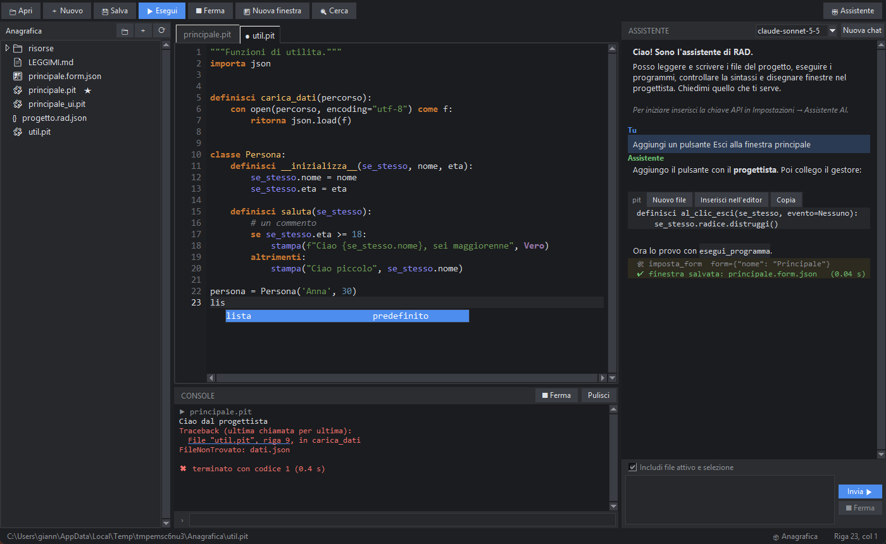

# L'editor di codice

## Colori e controllo degli errori

L'editor colora le **parole chiave** italiane (`se`, `per`, `definisci`…), le funzioni predefinite (`stampa`, `lunghezza`…), le costanti `Vero`/`Falso`/`Nessuno`,
le stringhe, i numeri, i commenti e i nomi che definisci. Mentre scrivi, PitStudio controlla la sintassi: la riga sbagliata si evidenzia in rosso con un
puntino rosso nel margine, e il messaggio (in italiano) compare nella barra di stato. Per un controllo a richiesta: *Esegui → Controlla la sintassi*.

## Suggerimenti

Dopo due lettere (o con **Ctrl+Spazio**) compare un elenco. Cosa propone dipende da dove sei:

| Situazione | Suggerimenti |
|---|---|
| In una riga qualsiasi | parole chiave, funzioni predefinite, nomi definiti nel file, frammenti |
| Dopo `importa` o `da` | i moduli, con quelli in italiano in cima (`interfaccia`, `percorso`, `data_ora`…) |
| Dopo un punto (`tk.`, `Percorso.`) | i membri dell'oggetto: PitStudio guarda cosa hai importato e ne legge i nomi, compresi gli alias italiani |
| Dopo `se_stesso.` | i metodi e gli attributi del file |

Usa **↑ ↓** per scegliere, **Tab** o **Invio** per accettare, **Esc** per chiudere. Se hai digitato un nome di un modulo del tuo progetto, PitStudio non lo importa
(per non eseguire il tuo codice solo per suggerirlo).

## Frammenti

Scrivi la parola e premi **Tab**: si espande in un blocco pronto. Il cursore si posiziona dove devi continuare.

| Parola | Risultato |
|---|---|
| `se` | `se condizione:` con il corpo |
| `per` | ciclo `per … in …:` |
| `mentre` | ciclo `mentre …:` |
| `definisci` | una funzione |
| `classe` | una classe con `__inizializza__` |
| `prova` | `prova / eccetto Eccezione come errore` |
| `con` | gestore di contesto `con … come …` |
| `principale` | il blocco `se __nome__ == "__main__":` |
| `finestra` | una finestra tkinter di base |

## Scrittura più veloce

- **Invio** mantiene il rientro e lo aumenta dopo i due punti; **Tab** inserisce lo spazio di una tabulazione, **Maiusc+Tab** riduce il rientro (anche su più righe selezionate).
- **Ctrl+/** commenta o decommenta le righe selezionate; **Ctrl+D** duplica la riga; **Alt+↑/↓** sposta la riga.
- Parentesi e virgolette si chiudono da sole; scrivendo la chiusura si «salta» oltre. **Backspace** su una coppia vuota la cancella.
- **Ctrl+F** apre Trova/Sostituisci (con conteggio dei risultati); **Ctrl+G** salta a una riga; **Ctrl+Z / Ctrl+Y** annullano e ripetono senza limite.
- Il salvataggio automatico si attiva nelle [impostazioni](#impostazioni).

## Python classico (.py)

L'editor apre anche i file **Python normale** (`.py`, parole inglesi): colori, suggerimenti, frammenti (`if`, `for`, `def`, `main`…) e controllo della sintassi
passano automaticamente alla lingua inglese, e **F5** li esegue con pitonit. Un file usa una sola lingua: `.pit` per le parole italiane, `.py` per quelle inglesi.
Con il clic destro su un `.py` → **Traduci in pytonIta** crei il `.pit` equivalente accanto all'originale (che non viene toccato). Il modello di progetto
**Programma Python classico** parte già con un `principale.py`.

## Punti di arresto

Un clic sul margine dei numeri di riga (o **F9**) mette un **punto di arresto**, un pallino rosso: il programma, avviato con il [debugger](#debugger) (F6), si ferma lì. I punti di arresto si ricordano insieme alla sessione del progetto.

## Guida contestuale

Con il cursore su una parola premi **F1**: si apre la sua scheda nel [riferimento del linguaggio](#linguaggio) (cosa significa, equivalente inglese, esempio).
Per un'idea su un pezzo di codice: seleziona il testo e usa *Strumenti → Chiedi all'AI di spiegare il codice selezionato*.

## Navigare nel codice

- **Vai alla definizione** (**F12**, oppure **Ctrl+clic** su un nome): apre il punto in cui una funzione, una classe o una costante è definita, anche in un altro file del progetto. Su un `importa modulo` apre il file del modulo; su una parola chiave (`se`, `per`…) apre la guida.
- **Trova gli usi** (**Maiusc+F12**): elenca tutti i punti del progetto dove si usa il nome sotto il cursore (non conta il testo tra virgolette né i commenti). Doppio clic su una riga per andarci; l'elenco resta aperto.
- **Rinomina in tutto il progetto** (**F2**): cambia un nome ovunque, anche nei file chiusi e nei gestori degli eventi dei form (`.form.json`). Mostra quanti punti cambiano e chiede conferma. Nei file aperti si annulla con Ctrl+Z.
- **Documentazione al passaggio del mouse**: fermando il mouse su un nome compare la firma e la descrizione di una tua funzione, oppure la spiegazione di una parola del linguaggio o di una funzione predefinita.
- **Ripulisci il codice** (**Ctrl+Maiusc+L**): toglie gli spazi a fine riga, trasforma le tabulazioni di rientro in quattro spazi e riduce a due le righe vuote di fila, senza toccare il testo dentro le virgolette.
- Il **clic destro** nell'editor apre un menu con tutti questi comandi.

Le voci sono anche nel menu *Modifica*. Le scorciatoie si cambiano in *Strumenti → Impostazioni*.
