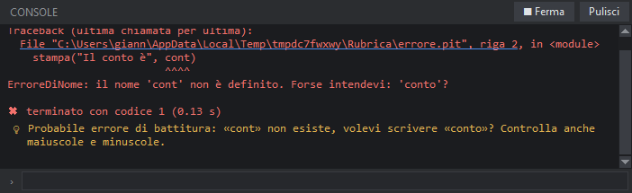

# Eseguire i programmi

## Esegui

- **F5** (o il pulsante blu **Esegui**) esegue il **file principale** del progetto; se non c'è, il file della scheda aperta.
- *Esegui → Esegui il file corrente* esegue il file che stai guardando.
- **Maiusc+F5** (o il pulsante quadrato) ferma il programma, anche se ha lanciato altri processi.
- Prima di eseguire PitStudio **salva tutto** (si può disattivare nelle [impostazioni](#impostazioni)).

I programmi girano con **pitonit** in un processo separato, nella cartella del progetto: se il programma apre finestre, le vedi comparire normalmente.

## La console

| Elemento | Cosa fa |
|---|---|
| Testo bianco | l'output normale (`stampa`) |
| Testo rosso | gli errori; il messaggio e il traceback sono **in italiano** |
| Link sottolineati | `File "x.pit", riga 9`: un clic apre il file alla riga e la segna in rosso |
| Riga in fondo (›) | scrivi qui e premi Invio per rispondere a `leggi_tastiera()`; il testo che invii appare in giallo |
| **Pulisci** | svuota la console (per default si svuota da sola a ogni esecuzione) |
| **Ferma** | interrompe il programma |

Alla fine vedi se il programma è terminato bene (✔ in verde) o con un codice di errore (✖ in rosso) e quanti secondi ha impiegato.

## I suggerimenti 💡

Quando un programma termina con un errore, sotto il messaggio compare una riga con 💡 che spiega **cosa è successo e come correggere**: una parola inglese dove serve l'italiano, un `:` mancante, un nome scritto male (con il nome giusto proposto), un modulo che non esiste, un file non trovato, un indice fuori dalla lista… Gli stessi suggerimenti compaiono accanto agli errori di sintassi segnalati nell'editor mentre scrivi. Vedi anche la [lezione sugli errori](#lezione-11).

## Il debugger

Per cercare un bug riga per riga usa il [debugger](#debugger) (F6).

## Argomenti e interprete

- Gli argomenti per il file principale si impostano in *Progetto → Proprietà del progetto…*; quelli validi per tutti i programmi nelle [impostazioni](#impostazioni) (*Esecuzione*).
- Se vuoi usare un'altra copia di pitonit, indicane il percorso nelle impostazioni (*Interprete*); vuoto = quello con cui gira PitStudio.

## Errori in italiano

Gli errori di sintassi e di esecuzione sono tradotti: `DivisionePerZero: divisione per zero`, `ErroreDiNome: il nome 'x' non è definito`…
I nomi inglesi delle eccezioni funzionano ancora nel codice (`ValueError` o `ErroreDiValore` sono la stessa cosa).

> **Suggerimento:** se non capisci un errore, usa *Strumenti → Chiedi all'AI di correggere l'ultimo errore*: l'assistente legge la console, trova la causa, corregge e riesegue.
