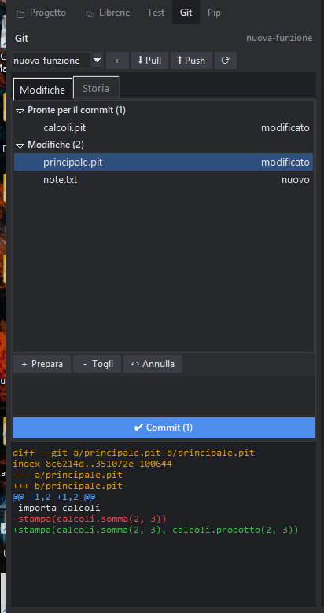

# Git: la storia del progetto

Git tiene la storia delle versioni del progetto: puoi tornare a com'era ieri, provare una modifica su un «ramo» senza rovinare il resto e lavorare con altre persone. PitStudio lo usa dal pannello **Git** (la linguetta «Git» a sinistra). Serve che Git sia installato (si scarica da git-scm.com): se manca, il pannello lo dice.

## Cominciare

Se la cartella del progetto non è ancora un repository, il pannello offre **Crea il repository Git qui**: crea il repository e un file `.gitignore` che esclude `__pycache__`, `.rad` e `.pacchetti`.

## Salvare una versione (commit)

1. In **Modifiche** vedi i file cambiati. Un clic mostra le differenze in basso (verde = aggiunto, rosso = tolto).
2. **＋ Prepara** mette i file scelti tra quelli «pronti» (senza scelta, tutti). **－ Togli** li rimette tra le modifiche.
3. Scrivi un messaggio che dice *cosa* hai cambiato e premi **✔ Commit**. La prima volta ti chiede nome ed email (compaiono nei commit).

**↶ Annulla** butta via le modifiche dei file scelti: tornano come nell'ultimo commit (i file nuovi vengono eliminati). Non si può tornare indietro, per questo chiede conferma.

## Storia e rami

- La scheda **Storia** elenca i commit; un clic mostra cosa ha cambiato.
- L'elenco in alto sceglie il **ramo** su cui lavorare; **＋** ne crea uno nuovo. Cambiando ramo i file aperti si aggiornano.
- **⬇ Pull** scarica le novità dal repository remoto (solo se non c'è nulla da unire); **⬆ Push** invia i tuoi commit. Accanto al nome del ramo, ↑2 ↓1 dicono quanti commit hai da inviare e da scaricare.

Le password dei servizi (GitHub e simili) le gestisce Git, non PitStudio: PitStudio non le vede e non le salva.
