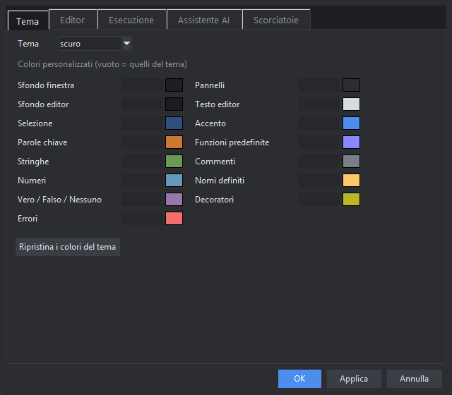

# Impostazioni

Apri *Strumenti → Impostazioni…* (o l'icona dell'ingranaggio). **Applica** applica subito senza chiudere, **OK** applica e chiude. Tutto viene salvato in `C:\Users\<tu>\.rad\config.json`:
per riportare PitStudio ai valori iniziali basta cancellare quel file.

## Tema

| Opzione | Descrizione |
|---|---|
| Tema | **scuro** o **chiaro** (si cambia anche da *Visualizza → Tema chiaro / scuro*) |
| Colori personalizzati | per ogni tema puoi cambiare sfondo, pannelli, editor, selezione, accento, i colori della sintassi (parole chiave, funzioni, stringhe, commenti, numeri…) e quello degli errori. Clic sul quadratino per scegliere il colore; vuoto = quello del tema |

## Editor

| Opzione | Descrizione |
|---|---|
| Carattere e dimensione | carattere a larghezza fissa (predefinito Consolas 11); anche con **Ctrl +/−** |
| Spazi per tabulazione | 4 per default |
| Numeri di riga, riga corrente evidenziata, a capo automatico | attivabili a piacere |
| Chiudi automaticamente parentesi e virgolette | per scrivere più in fretta |
| Suggerimenti automatici e ritardo | puoi spegnerli (restano su **Ctrl+Spazio**) o regolarne la prontezza |
| Salvataggio automatico | dopo N secondi dall'ultima modifica (0 = mai) |

## Esecuzione

| Opzione | Descrizione |
|---|---|
| Interprete pitonit | vuoto = quello di PitStudio |
| Argomenti del programma | validi per ogni esecuzione |
| Salva tutto prima di eseguire | consigliato |
| Pulisci la console a ogni esecuzione | per vedere solo l'ultima prova |

## Assistente AI

| Opzione | Descrizione |
|---|---|
| Chiave API Anthropic | obbligatoria per usare l'assistente |
| Modello | quale modello usare; l'elenco nel menu della chat si modifica in `config.json` (`ai.modelli`) |
| Lunghezza massima della risposta | token massimi per risposta |
| Passi massimi per richiesta | quanti strumenti può usare l'assistente di seguito prima di fermarsi |
| Conferme su scrittura ed esecuzione | consigliate; spegnile solo se ti fidi del lavoro automatico |
| Includi file attivo e selezione | manda all'assistente il contesto dell'editor |
| Indirizzo dell'API | per usare un servizio compatibile diverso |
| Istruzioni aggiuntive | testo che l'assistente legge a ogni richiesta (stile, convenzioni del tuo progetto…) |

## Scorciatoie

Ogni scorciatoia si scrive nel formato di Tk: `Control-s`, `Control-Shift-S`, `F5`, `Alt-Up`… Le modifiche valgono subito. L'elenco completo è in [Scorciatoie da tastiera](#scorciatoie).

## Disposizione

La dimensione della finestra, dei pannelli e quali pannelli sono visibili si salvano da soli quando chiudi PitStudio.
