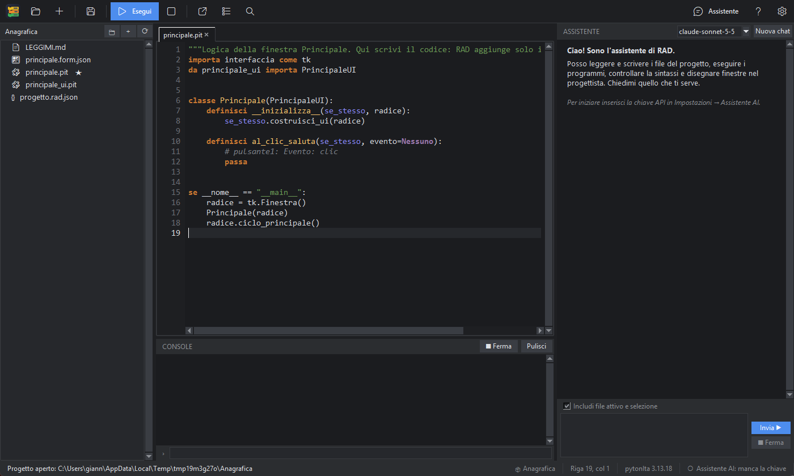

# L'interfaccia

## Le aree

| Area | A cosa serve |
|---|---|
| **Barra degli strumenti** (in alto) | Apri/Nuovo progetto, Salva, **Esegui** e Ferma, nuova finestra, nuovo programma a mattonelle, Cerca; a destra Assistente, Guida, Impostazioni. Passa il mouse su un pulsante per vedere il suggerimento e la scorciatoia |
| **Progetto** (a sinistra) | L'albero dei file della cartella del progetto. Doppio clic apre un file; clic destro per nuovo file, rinomina, elimina, converti… |
| **Schede** (al centro) | Ogni file aperto ha la sua scheda: editor di codice, visualizzatore di immagini/JSON/tabelle, progettista di finestre, editor a mattonelle. La **✕** chiude la scheda; un pallino ● indica modifiche non salvate |
| **Console** (sotto le schede) | L'output dei programmi, gli errori con link alla riga e la riga per scrivere all'input del programma |
| **Assistente** (a destra) | La chat con l'AI |
| **Barra di stato** (in basso) | Messaggi, posizione del cursore, versione dell'interprete e stato dell'assistente |

## Cambiare la disposizione

- Trascina i separatori tra le aree per cambiarne le dimensioni.
- Da *Visualizza* puoi nascondere il pannello Progetto, la Console e l'Assistente: utile quando serve spazio per il progettista o per le mattonelle.
- PitStudio ricorda la disposizione, le schede aperte e l'ultimo progetto: alla riapertura ritrovi tutto com'era.
- **Ctrl +** e **Ctrl −** cambiano la dimensione del testo; il tema chiaro/scuro si cambia da *Visualizza → Tema chiaro / scuro*.

## Menu

- **File**: progetti, nuovi file, finestre e programmi a mattonelle, conversione, salva, esci.
- **Modifica**: annulla/ripeti, trova e sostituisci, vai a riga, commenta, duplica riga, suggerimenti.
- **Progetto**: cerca nel progetto, aggiungi risorse, file principale, proprietà.
- **Esegui**: esegui il file principale o quello corrente, ferma, controlla la sintassi.
- **Visualizza**: pannelli, tema, zoom. **Strumenti**: impostazioni, chiedi all'AI di spiegare/correggere, manuale pytonIta. **Aiuto**: questa guida.
