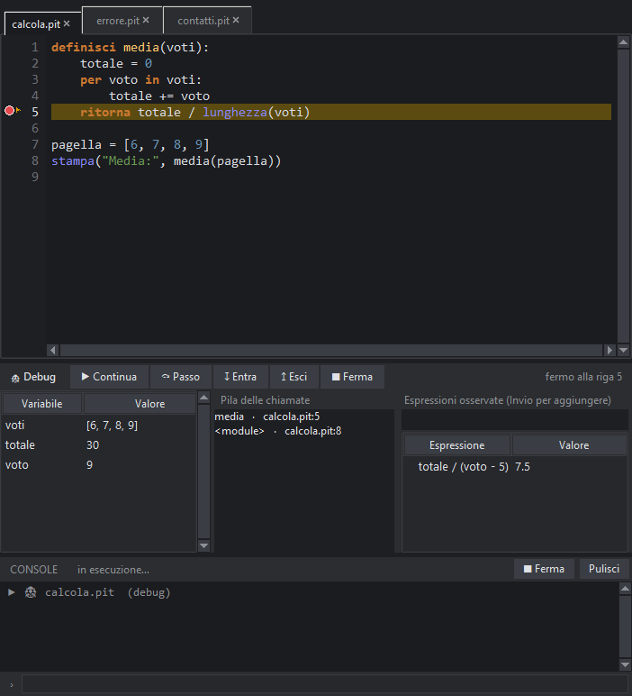

# Lezione 12 · Il debugger

**Obiettivo:** scovare i bug guardando il programma **mentre funziona**, riga per riga.

## Quando serve

A volte il programma parte, non dà errori… ma il risultato è sbagliato. Invece di riempirlo di `stampa` per capire cosa succede, puoi usare il **debugger**: fermi il programma dove vuoi, guardi i valori delle variabili e avanzi una riga alla volta.

## Un programma con un bug

Questo programma dovrebbe calcolare la media di una lista di voti, ma stampa un risultato strano:

```pit
definisci media(voti):
    totale = 0
    per voto in voti:
        totale += voto
    ritorna totale / lunghezza(voti) + 1

pagella = [6, 7, 8, 9]
stampa("Media:", media(pagella))
```

```output
Media: 8.5
```

La media di 6, 7, 8, 9 dovrebbe essere 7.5, non 8.5. Dov'è l'errore? Cerchiamolo.

## Punto di arresto

Un **punto di arresto** (*breakpoint*) è una riga in cui il programma si ferma. Per metterlo:

- **clicca sul margine** a sinistra del numero di riga: compare un **pallino rosso** (clicca di nuovo per toglierlo);
- oppure metti il cursore sulla riga e premi **F9**.

Metti un punto d'arresto sulla riga `ritorna totale / ...`.

## Avviare il debugger

Premi **F6** (o il pulsante con l'insetto 🐞 nella barra). Il programma parte e si ferma sul tuo punto: la riga si evidenzia di giallo con una freccia ▶ nel margine e sotto l'editor compare il **pannello Debug**:

| Zona | Cosa mostra |
|---|---|
| **Variabili** | i nomi e i valori in questo momento (qui `totale = 30`, `voti = [6, 7, 8, 9]`) |
| **Pila delle chiamate** | le funzioni attive: `media` chiamata dal programma principale. Clicca una riga per saltare lì |
| **Espressioni osservate** | scrivi un'espressione (per esempio `totale / lunghezza(voti)`) e premi Invio: ne vedi il valore a ogni sosta |

Vedi subito che `totale / lunghezza(voti)` vale 7.5: il `+ 1` è il bug!



## I comandi

| Pulsante | Tasto | Cosa fa |
|---|---|---|
| ▶ Continua | **F5** | riprende fino al prossimo punto di arresto (o alla fine) |
| ⤼ Passo | **F10** | esegue **una riga** e si ferma (le funzioni chiamate vengono eseguite d'un fiato) |
| ↧ Entra | **F11** | se la riga chiama una funzione, ci **entra dentro** |
| ↥ Esci | **Maiusc+F11** | finisce la funzione corrente e torna a chi l'ha chiamata |
| ■ Ferma | **Maiusc+F5** | interrompe il programma |

Per partire **dalla prima riga** senza punti di arresto: menu *Esegui → Debug: avvia passo passo dalla prima riga*.

## Come ragionare

1. **Sospetta** dove può essere l'errore e metti lì un punto di arresto.
2. **Guarda i valori**: sono quelli che ti aspettavi?
3. **Avanza di una riga** e guarda cosa cambia.
4. Il primo punto in cui un valore **smette di essere quello giusto** è vicino al bug.
5. Correggi, togli i punti di arresto (*Esegui → Togli tutti i punti di arresto*) e riprova.

Versione corretta:

```pit
definisci media(voti):
    totale = 0
    per voto in voti:
        totale += voto
    ritorna totale / lunghezza(voti)

pagella = [6, 7, 8, 9]
stampa("Media:", media(pagella))
```

```output
Media: 7.5
```

## Debug senza debugger: stampa

Per problemi semplici, anche una `stampa` temporanea va bene:

```pit
n = 7
risultato = n * 2
stampa("DEBUG n =", n, "risultato =", risultato)
```

```output
DEBUG n = 7 risultato = 14
```

Ricordati però di toglierle quando hai finito.

## Esercizi

1. Questa funzione dovrebbe restituire la somma dei numeri da 1 a n, ma dà 55 invece di 45 per `n = 9`. Trova il bug con il debugger.

```pit
definisci somma_fino_a(n):
    totale = 0
    per i in intervallo(1, n + 2):
        totale += i
    ritorna totale

stampa(somma_fino_a(9))
```

```output
55
```

2. Prova **Entra** (F11) su una riga che chiama una tua funzione e poi **Esci** (Maiusc+F11).
3. Aggiungi tra le espressioni osservate `i * 2` mentre il ciclo gira.

## Soluzione

Il ciclo va fino a `n + 2` escluso, quindi arriva a `n + 1`. Deve essere `intervallo(1, n + 1)`:

```pit
definisci somma_fino_a(n):
    totale = 0
    per i in intervallo(1, n + 1):
        totale += i
    ritorna totale

stampa(somma_fino_a(9))
```

```output
45
```
