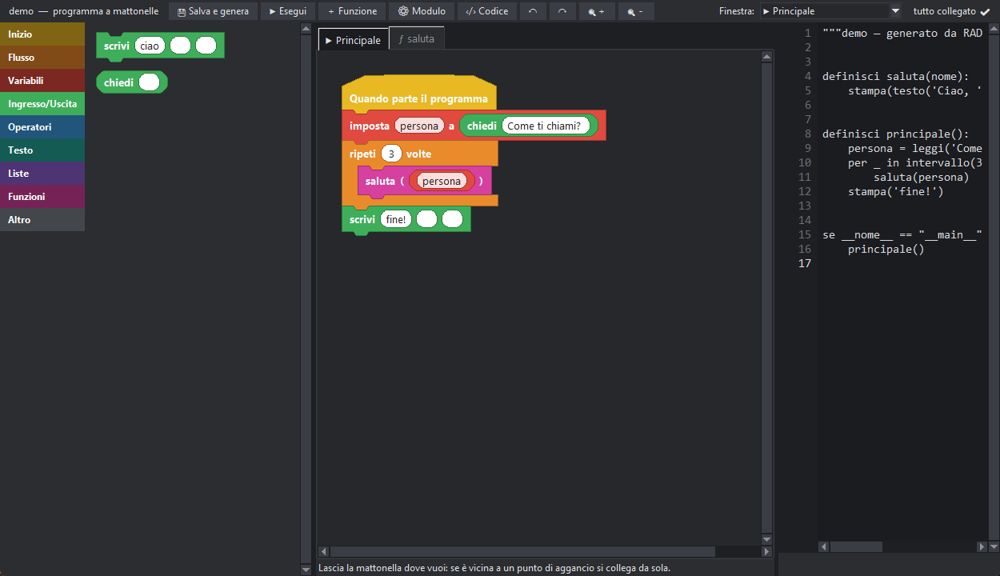

# Lezione 23 · Programmare a mattonelle

**Obiettivo:** costruire un programma **incastrando blocchi**, e capire che sotto le mattonelle c'è sempre il solito codice, quello che hai imparato in queste lezioni.



## Perché le mattonelle

Con le mattonelle non scrivi le parole: le **trascini**. Non puoi sbagliare le parentesi o i due punti, perché le forme si incastrano solo dove hanno senso. È comodo per:

- **cominciare**: ti concentri sulla logica, non sulla sintassi;
- **capire** un programma di altri, vedendone la forma;
- **costruire** programmi anche grandi (funzioni, classi e metodi hanno ognuno la propria pagina).

Non è un gioco a parte: PitStudio traduce le mattonelle in codice pytonIta **vero**, che puoi vedere, eseguire e usare in un normale progetto.

## Iniziare

1. Premi il pulsante **▦** nella barra (oppure *File → Nuovo programma a mattonelle…*) e scegli un nome.
2. A sinistra c'è la **tavolozza**, divisa per categorie; al centro l'**area di lavoro**; a destra, se premi **‹/› Codice**, vedi il codice pytonIta che si scrive da solo.

## Le forme e i colori

Ogni tipo di mattonella ha una forma, così capisci a colpo d'occhio cosa fa:

| Forma | Cosa è | Esempi |
|---|---|---|
| **Cappello** (giallo) | l'inizio di una pila | *Quando parte il programma*, *definisci funzione* |
| **Istruzione** | si incastra sopra e sotto | *scrivi*, *imposta*, *cambia* |
| **Blocco** a «C» | contiene altre mattonelle | *se*, *per ogni*, *mentre* |
| **Valore** a pillola | si infila in una casella | numeri, testi, variabili |
| **Condizione** a esagono | è vera o falsa | *=*, *<*, *e*, *non* |

Le pile **non attaccate a un cappello non vengono eseguite**: PitStudio te lo segnala con la scritta «non collegato».

## Il tuo primo programma, a mattonelle

Obiettivo: stampare i numeri pari da 1 a 10. Costruiscilo così:

1. Parti dal cappello **Quando parte il programma**.
2. Trascina sotto un blocco **per ogni … in …** (categoria Flusso). Come elenco infila la mattonella `intervallo_di(1, 11)`.
3. Dentro la «C» metti un blocco **se** con la condizione `n % 2 = 0`.
4. Dentro il **se** metti **scrivi** con il valore `n` (la variabile del ciclo).
5. Premi **Esegui**: la console mostra 2, 4, 6, 8, 10.

Apri ora **‹/› Codice**. Vedrai questo:

```pit
per n in intervallo_di(1, 11):
    se n % 2 == 0:
        stampa(n)
```

```output
2
4
6
8
10
```

Sono le stesse parole che hai scritto nelle lezioni 4 e 5: **le mattonelle sono solo un altro modo di scriverle**. Le forme a «C» corrispondono ai blocchi rientrati, i valori a pillola alle espressioni.

## Funzioni a mattonelle

Premi **＋ Funzione**, scegli il nome (per esempio `quadrato`) e i parametri (`x`). Si apre una scheda con il cappello **definisci quadrato (x)**: costruisci il corpo e chiudi con **restituisci**. Poi trascina la funzione nel flusso principale, nella forma *chiama* o in quella *valore*. Un doppio clic su una chiamata apre la funzione.

```pit
definisci quadrato(x):
    ritorna x * x

stampa(quadrato(7))
```

```output
49
```

## Staccare e spostare

I collegamenti non sono fissi: **afferra una mattonella e portala via**.

- una **istruzione** si porta dietro tutte quelle che la seguono (con **Alt** porti via solo lei);
- un **valore** esce dall'ingresso e resta libero: puoi infilarlo altrove;
- lasciando una mattonella sulla tavolozza la **elimini**;
- **↶ ↷** annullano e ripetono qualsiasi modifica, **Ctrl + rotella** cambia lo zoom.

## Dal codice alle mattonelle (e ritorno)

Hai già un programma scritto? Apri il file `.pit` e usa la conversione **da codice a mattonelle**: PitStudio lo trasforma in blocchi. Il viceversa è automatico: il codice si genera sempre. Puoi quindi **alternare** i due modi: iniziare a mattonelle e rifinire a mano, o viceversa. Per i dettagli vedi la guida [Programmi a mattonelle](#mattonelle) e [Conversione](#conversione).

Quando conviene il testo? Appena scrivere diventa più veloce che trascinare (programmi lunghi, molte espressioni). Quando conviene la mattonella? Per progettare la logica, spiegarla a qualcuno, o quando stai ancora imparando le parole.

## Esercizi

1. Costruisci a mattonelle un programma che stampa la **tabellina del 7** (da 7×1 a 7×10). Poi apri il codice e leggi com'è fatto.
2. Crea la funzione `somma_di_tre(a, b, c)` a mattonelle e richiamala dal flusso principale con tre numeri.
3. Scrivi **a mano** il codice di un conto alla rovescia da 5 a 1, poi converti il file in mattonelle e osserva come si presenta.

## Soluzioni

Per l'esercizio 1 il codice generato è:

```pit
per n in intervallo_di(1, 11):
    stampa(f"7 x {n} = {7 * n}")
```

```output
7 x 1 = 7
7 x 2 = 14
7 x 3 = 21
7 x 4 = 28
7 x 5 = 35
7 x 6 = 42
7 x 7 = 49
7 x 8 = 56
7 x 9 = 63
7 x 10 = 70
```

Per l'esercizio 2:

```pit
definisci somma_di_tre(a, b, c):
    ritorna a + b + c

stampa(somma_di_tre(1, 2, 3))
```

```output
6
```

Per l'esercizio 3 (prima di convertirlo):

```pit
per n in intervallo_di(5, 0, -1):
    stampa(n)
stampa("Via!")
```

```output
5
4
3
2
1
Via!
```
