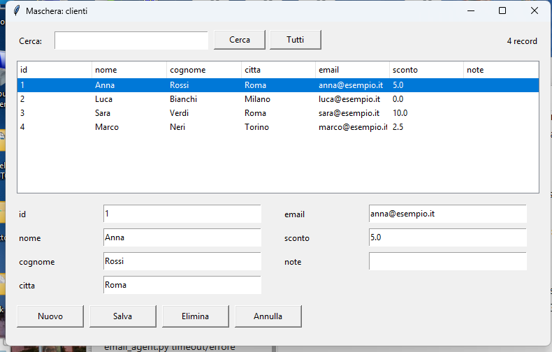

# Maschere collegate ai dati

Una **maschera** è una finestra che mostra e modifica i record di una tabella: un elenco, i campi di un record e i pulsanti per cercare, aggiungere, salvare ed eliminare. PitStudio la crea **da solo** partendo da una tabella.



## Come si crea

1. Apri un progetto e il database (SQLite o MySQL, vedi «I database»).
2. Nella scheda del database scegli a sinistra la tabella.
3. Premi **▤ Maschera…** (oppure *Database → Crea una maschera dalla tabella…*) e scrivi il nome della finestra.

PitStudio crea nel progetto:

| File | A cosa serve |
|---|---|
| `nome.form.json` e `nome_ui.pit` | la finestra, che si modifica **nel progettista** (la apre subito) |
| `nome.pit` | la tua logica (vuota): aggiungici il codice che vuoi |
| `fonte_dati.pit` | il collegamento ai dati, usabile anche da altre finestre |

La maschera usa i **componenti dei dati** (vedi «Dati nelle finestre»): una *fonte dati*, la *barra di navigazione* con la ricerca, un *albero* e un campo per ogni colonna, tutti legati con le proprietà *Fonte dati* e *Campo*.

Per provarla: nel file `nome.pit` scegli *Esegui → Esegui il file corrente*.

## Cosa fa la maschera

- **Albero** dei record (fino a 2000): scegliendone uno compaiono i suoi valori nei campi.
- **Cerca** trova i record che contengono il testo in una qualunque colonna; **Tutti** toglie la ricerca.
- **Nuovo** svuota i campi; **Salva** aggiunge il record o aggiorna quello scelto; **Elimina** lo toglie (chiede conferma); **Annulla** torna ai valori salvati.
- Controlla i dati prima di scrivere: un campo obbligatorio (*NOT NULL* senza valore predefinito) deve essere compilato e un campo numerico deve contenere un numero (la virgola va bene: `2,5`).
- Le colonne che il database riempie da solo (chiave con auto-incremento) si lasciano vuote.

## Personalizzarla

Apri la finestra nel progettista: sposta i campi, cambia i testi, i colori e il carattere, aggiungi altri componenti legati alla stessa fonte (ognuno con la sua *Fonte dati* e il suo *Campo*) o togli i pulsanti che non servono dalla barra di navigazione. I campi si chiamano `campo_<colonna>`, l'albero `elenco_dati`, la barra `barra`, la fonte `fonte`.

Dal codice la fonte è un oggetto con `corrente()`, `valore("citta")`, `successivo()`, `salva()`… (vedi «Dati nelle finestre»). Per una finestra scritta a mano si può anche usare `FonteDati`:

```
da fonte_dati importa FonteDati

fonte = FonteDati.sqlite("dati.db", "clienti")
per id_, valori in fonte.record("roma"):          # record: lista di (identificatore, {colonna: valore})
    stampa(valori["nome"])
```

Per MySQL: `FonteDati.con_mysql(server, porta, utente, password, database, "clienti")`. Nelle maschere create da PitStudio la **password viene chiesta all'avvio** e non è mai scritta nel file.

## Dopo

- *Esporta il progetto come Python* e *Crea l'eseguibile (.exe)* funzionano anche con le maschere: il database SQLite del progetto viene copiato insieme al resto.
