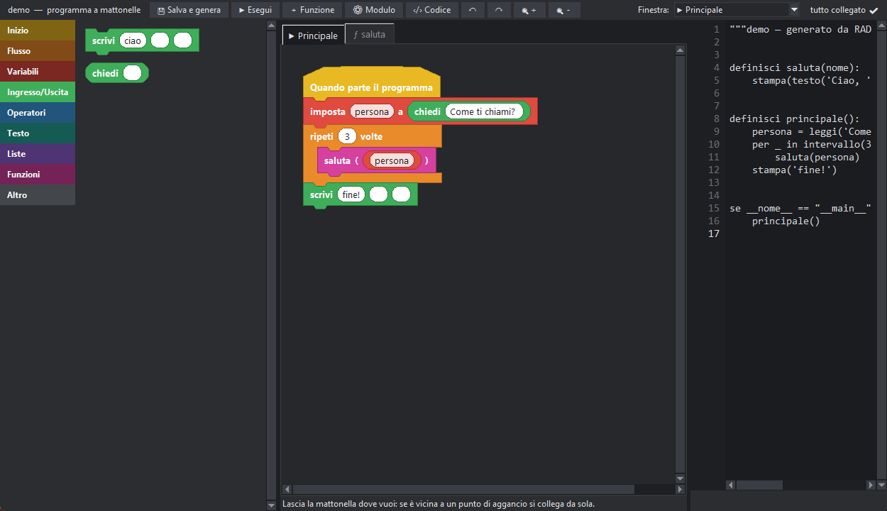

# Programmi a mattonelle

Il modo a mattonelle ti fa costruire un programma **incastrando blocchi colorati**, senza scrivere codice. Dietro le quinte PitStudio lo trasforma in codice pytonIta vero,
che puoi vedere, eseguire e anche usare in un normale progetto.



## Iniziare

Premi il pulsante **▦** nella barra (oppure *File → Nuovo programma a mattonelle…*) e scegli un nome. Si apre l'editor a mattonelle con:

- a sinistra la **tavolozza**: le mattonelle disponibili, divise per categoria (clic sul nome della categoria);
- al centro l'**area di lavoro**: una finestra per il **flusso principale** (scheda «▶ Principale») e **una per ogni funzione** (schede «ƒ nome»);
- a destra, a richiesta (**‹/› Codice**), il **codice pytonIta** generato in tempo reale, con gli avvisi sotto.

## Forme e colori

Ogni tipo di comando ha una forma e un colore, così capisci a colpo d'occhio cosa fa.

| Forma | Si riconosce da | Esempi |
|---|---|---|
| **Cappello** (giallo) | la «cupola» in alto: è l'inizio di una pila | *Quando parte il programma*, *definisci funzione* |
| **Istruzione** | incastri in alto e in basso | *scrivi*, *imposta*, *cambia*, *chiama* |
| **Blocco** (arancione, a «C») | contiene altre mattonelle | *se*, *se/altrimenti*, *per ogni*, *ripeti*, *mentre*, *prova*, *con file* |
| **Chiusura** | non ha incastro in basso | *restituisci*, *esci dal ciclo*, *salta al prossimo giro* |
| **Valore** | a pillola: si infila in un ingresso | numeri, testi, variabili, operazioni |
| **Condizione** | a esagono: vera o falsa | *=*, *<*, *e*, *o*, *non*, *è in* |

Colori delle categorie: **giallo** inizio · **arancione** flusso · **rosso** variabili · **verde** ingresso/uscita · **azzurro** operatori e numeri · **verde acqua** testo · **viola** liste · **magenta** funzioni · **grigio** altro.

## Costruire un programma

1. **Trascina** una mattonella dalla tavolozza: mentre la porti, un segno giallo mostra dove si aggancerà. Lasciala quando il segno è dove vuoi.
2. Una mattonella si aggancia **sotto un'altra**, **dentro un blocco** (la «bocca» della C), **sopra una pila** oppure in un **ingresso** (le caselle bianche o a esagono).
3. Per scrivere un valore, **clicca sulla casella** e digita: un numero, una frase o anche un'espressione. Per usare una variabile o un calcolo, trascina la mattonella-valore dentro la casella.
4. Premi **Esegui**: PitStudio salva, genera il codice e lo lancia; l'output compare nella console.

## Staccare e spostare i collegamenti

I collegamenti non sono fissi: **afferra una mattonella e portala via**.

- Una **istruzione** si porta dietro tutte quelle che la seguono. Tieni premuto **Alt** per portare via solo lei, o usa il clic destro → *Stacca solo questa*.
- Un **valore** esce dal suo ingresso e resta libero: puoi lasciarlo altrove o infilarlo in un altro ingresso. Se l'ingresso di arrivo era occupato, il vecchio valore resta libero accanto.
- Lascia la mattonella **sulla tavolozza** per eliminarla (i cappelli non si eliminano).
- Il clic destro offre anche: *Duplica*, *Duplica con le seguenti*, *Elimina*, *Elimina con le seguenti*, e sullo sfondo *Ordina le pile libere* o *Elimina ciò che non è collegato*.
- Le pile non attaccate a un cappello **non vengono eseguite**: lo vedi dalla scritta «non collegato» e dall'avviso nel pannello del codice.

## Variabili

Nella categoria **Variabili** trovi *imposta … a …*, *cambia … di …*, *usa la variabile globale …* e una mattonella per ogni variabile già usata (da trascinare dentro un ingresso).
Clicca sul nome in una mattonella per scegliere da un elenco o creare una **Nuova variabile…**: puoi renderla **globale** (condivisa da tutte le funzioni: PitStudio aggiunge da solo la dichiarazione `globale`) o locale alla finestra.

## Funzioni

1. **＋ Funzione** crea una finestra di lavoro con il suo cappello *definisci nome ( parametri )*: scegli nome e parametri (separati da virgola).
2. Costruisci il corpo della funzione nella sua scheda; usa **restituisci** per dare un valore. Dentro la funzione i parametri sono variabili.
3. La funzione compare nella categoria **Funzioni**, in due forme: istruzione (*chiama*) e valore (da infilare in un ingresso). Trascinala nel flusso principale o in un'altra funzione.
4. **Doppio clic** su una chiamata apre la funzione. Il menu *Finestra:* in alto salta a qualsiasi finestra (comodo con molte funzioni).
5. Clic destro su una scheda → **Apri in una finestra separata** (resta sincronizzata) oppure **Elimina la funzione**. Per rinominare la funzione, clicca il suo nome nel cappello: le chiamate si aggiornano da sole.

La categoria Funzioni contiene anche **chiama** e **chiamata**: servono per usare qualsiasi funzione o metodo scrivendone il nome (per esempio `sqrt` o `nomi.aggiungi`).

## Altre funzioni utili

- **↶ ↷** annullano e ripetono qualsiasi modifica; **🔍＋ 🔍−** (o **Ctrl + rotella**) cambiano lo zoom.
- **⚙ Modulo** apre le *importazioni* e il *codice di modulo* (classi, costanti) del programma: serve soprattutto per i programmi [convertiti](#conversione).
- **Salva e genera** scrive due file: `nome.mattonelle.json` (il disegno) e `nome.pit` (il codice, da non modificare a mano).
- Le mattonelle **codice** ed **espressione** (categoria Altro) accettano pytonIta scritto a mano, per tutto ciò che non ha una mattonella.

## Esempio

Il calcolo del fattoriale: una funzione `fattoriale(n)` con un *se n ≤ 1 → restituisci 1* e un *restituisci n × fattoriale(n − 1)*; nel flusso principale *scrivi «5! = » unisci fattoriale(5)*.
Genera:

```pit
definisci fattoriale(n):
    se n <= 1:
        ritorna 1
    ritorna n * fattoriale(n - 1)


definisci principale():
    stampa(testo('5! = ') + testo(fattoriale(5)))
```
