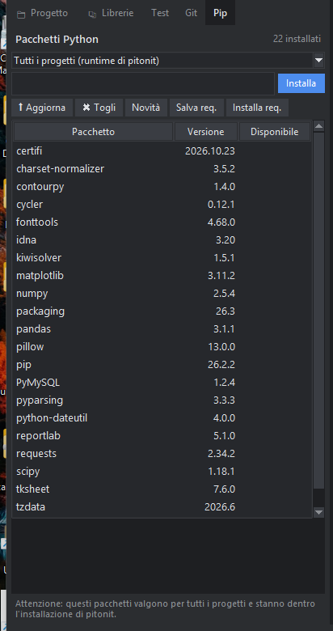

# I pacchetti Python (pip)

Oltre alle librerie italiane incluse, puoi usare i pacchetti Python pubblicati su PyPI (`requests`, `rich`, …). Il pannello **Pip** (la linguetta «Pip» a sinistra) li installa, li aggiorna e li toglie con pip, senza scrivere comandi.

## Dove vengono installati

| Scelta | Dove | Quando usarla |
|---|---|---|
| **Questo progetto (.pacchetti)** | nella cartella `.pacchetti` del progetto | quasi sempre: ogni progetto ha i **suoi** pacchetti e non si disturbano tra loro |
| **Tutti i progetti** | dentro l'installazione di pitonit | per ciò che ti serve ovunque |

I programmi lanciati da PitStudio (F5, debug, test) trovano da soli i pacchetti di `.pacchetti`: scrivi semplicemente `importa requests`.

## Cosa si può fare

- **Installa**: scrivi il nome (`requests`, `rich>=13`, `numpy==2.5.4`, oppure il file `.whl` di un pacchetto) e premi Invio.
- **⬆ Aggiorna** installa l'ultima versione del pacchetto scelto; **✖ Togli** lo disinstalla.
- **Novità** controlla (serve la rete) quali pacchetti hanno una versione più nuova: compaiono nella colonna «Disponibile».
- **Salva req.** scrive `requirements.txt` nel progetto con tutto quello che è installato; **Installa req.** installa tutto quello che c'è in `requirements.txt`, utile su un altro computer.

Quello che pip risponde (gli errori compresi) compare nell'area in basso. Per i pacchetti scritti in C o con librerie di sistema, l'installazione può fallire se non esiste una versione già compilata per Windows.
