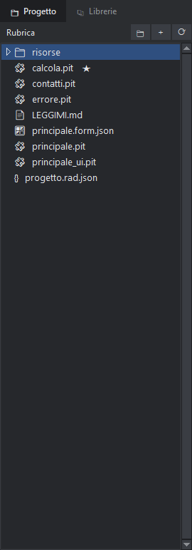
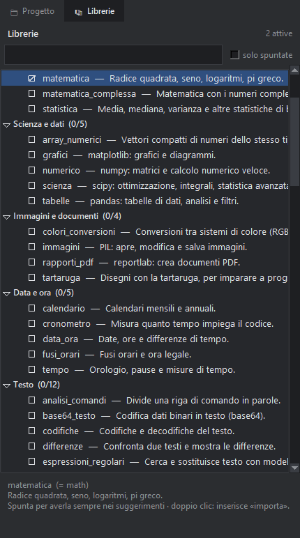
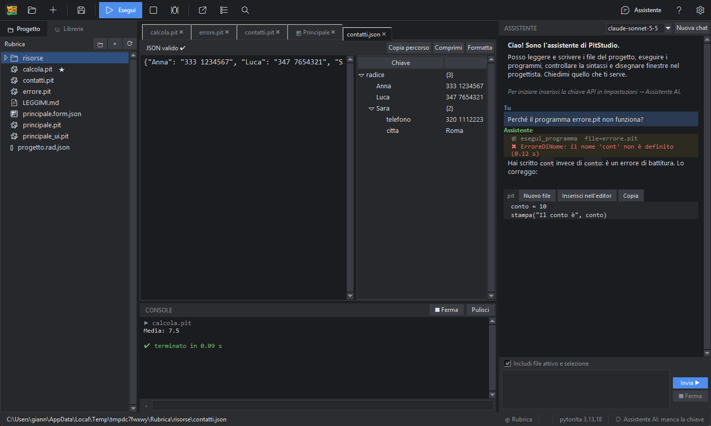

# Progetti, file e risorse

## Che cos'è un progetto

Un progetto è una **cartella** che contiene un file `progetto.rad.json` (il nome, il file principale, gli argomenti da passare al programma) e i tuoi file.
Per aprire un progetto scegli la sua cartella; se la cartella non ha ancora il file di progetto, PitStudio ti chiede se trasformarla in progetto.
I progetti recenti compaiono nel menu *File → Progetti recenti* e nella schermata di benvenuto.

## I modelli

| Modello | Cosa crea |
|---|---|
| **Programma da console** | `principale.pit` con un programma che legge e scrive testo |
| **Programma con finestra** | una finestra già disegnata (`principale.form.json`, il codice generato e la logica) |
| **Programma a mattonelle** | un programma di esempio a mattonelle già collegato |
| **Libreria** | un pacchetto con `__init__.pit` e un file di prova |
| **Progetto vuoto** | solo un `principale.pit` minimo |

## L'albero dei file

- **Doppio clic** o **Invio** apre un file nel visualizzatore giusto: codice → editor, immagini → anteprima, `.json` → editor JSON, `.csv` → tabella, `.form.json` → progettista, `.mattonelle.json` → editor a mattonelle.
- **Clic destro** per: nuovo file, nuova cartella, nuova finestra, nuovo programma a mattonelle, aggiungi risorse, rinomina (**F2**), elimina (**Canc**), mostra in Esplora risorse, *Converti in mattonelle…* (sui file `.pit`).
- La **★** segna il **file principale**: quello che **F5** esegue. Cambialo con *Imposta come file principale*.
- Le cartelle `__pycache__`, `.git` e `.rad` non vengono mostrate. `.rad` contiene la tua sessione (schede aperte) e la chat con l'assistente.

## Le librerie del progetto

A sinistra, accanto alla scheda **Progetto**, la scheda **Librerie** mostra tutte le librerie italiane divise per categoria, ognuna con una breve descrizione. Spunta la casella per **attivare** una libreria nel progetto (la scelta si salva con il progetto): le librerie attive compaiono sempre tra i suggerimenti dell'editor e i loro nomi si completano anche senza `importa`. Un **doppio clic** inserisce la riga `importa …` in testa al file aperto (in un `.py` inserisce l'`import` inglese). Il campo di ricerca filtra per nome o descrizione; «solo spuntate» mostra solo quelle attive. Le librerie segnate con ⚠ non sono installate (le scientifiche sono un componente facoltativo dell'installazione).

## Cercare nel progetto

*Progetto → Cerca nel progetto…* (o il pulsante con la lente) cerca un testo in tutti i file. Doppio clic su un risultato apre il file alla riga giusta.

## Le risorse

Con **Aggiungi risorse…** scegli immagini, JSON, tabelle o qualsiasi file: vengono copiati nella cartella `risorse` del progetto.

### Immagini
Anteprima con **Adatta**, **100%**, **＋/−** e **Ctrl + rotella** per ingrandire. In alto vedi le dimensioni, il modo colore e il peso del file.

### File JSON

A sinistra il testo, a destra la **struttura ad albero** (chiave, valore, tipo). L'editor dice subito se il JSON è valido (✔) o dov'è l'errore (riga evidenziata).
**Doppio clic** su un valore lo modifica; *Formatta* lo impagina, *Comprimi* lo riduce a una riga, *Copia percorso* copia il percorso del nodo (`$.campi[2].tipo`).

### Tabelle CSV e TSV
Mostrate come tabella (fino a 3000 righe), con riconoscimento automatico del separatore.

### File binari
Dump esadecimale dei primi 64 KB, con la colonna dei caratteri.
