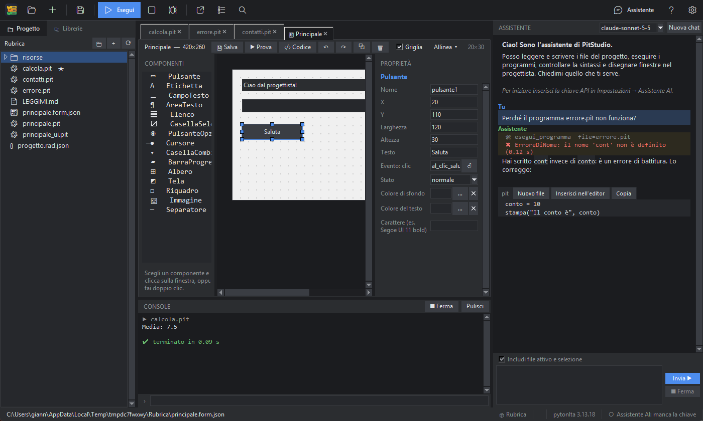
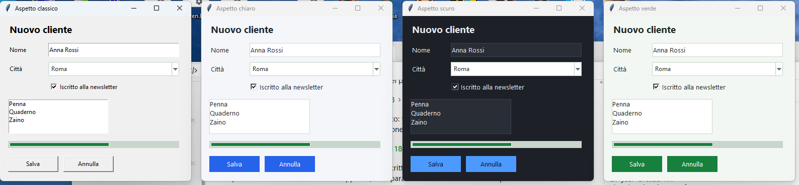

# Il progettista di finestre

Il progettista ti fa costruire una finestra con il mouse. Non devi scrivere il codice dell'aspetto: PitStudio lo genera, e tu scrivi solo quello che succede quando l'utente fa qualcosa.



## Creare una finestra

*File → Nuova finestra (progettista)…* (o il pulsante nella barra). Scegli un nome (lettere, cifre e `_`, senza parole riservate). Si apre la scheda con tre colonne:

1. **Componenti** (palette): l'elenco di ciò che puoi inserire.
2. **La finestra**: l'area di disegno con la griglia.
3. **Proprietà**: le impostazioni del componente scelto (o della finestra, se non hai scelto niente).

## Inserire e muovere i componenti

- Scegli un componente nella palette e **clicca sulla finestra** per inserirlo (o fai doppio clic nella palette).
- **Trascina** un componente per spostarlo; usa le **otto maniglie** blu per ridimensionarlo. Anche la **finestra stessa** si ridimensiona: trascina le maniglie fuori dal suo bordo destro, dal bordo inferiore o dall'angolo. Con la griglia attiva si allinea a passi di 8 punti.
- **Maiusc+clic** aggiunge alla selezione; **Ctrl+A** seleziona tutto. Le **frecce** spostano di un punto (con Maiusc di dieci).
- **Ctrl+C / Ctrl+V**, **Ctrl+D** copiano e duplicano; **Canc** elimina; **Ctrl+Z / Ctrl+Y** annullano e ripetono.
- Il menu **Allinea** dispone più componenti: a sinistra, a destra, in alto, in basso, centrati, stessa larghezza o altezza, distribuiti in modo uniforme.

## I componenti

| Componente | Per cosa serve |
|---|---|
| **Pulsante** | un pulsante con evento *clic* |
| **Etichetta** | testo fisso, con allineamento |
| **CampoTesto** | una riga di testo (anche nascosta, per le password); evento *Invio* |
| **AreaTesto** | testo su più righe |
| **Elenco** | un elenco di voci; evento *selezione* |
| **CasellaSelezione** | una casella da spuntare |
| **PulsanteOpzione** | scelta tra più opzioni dello stesso *gruppo* |
| **Cursore** | un cursore con minimo, massimo e valore; evento *cambio* |
| **CasellaCombinata** | un menu a tendina |
| **BarraProgresso** | una barra di avanzamento |
| **Albero** | una tabella con colonne (anche gerarchica) |
| **Tela** | un'area dove disegnare |
| **Riquadro** | un contenitore decorativo con bordo |
| **Immagine** | un'immagine presa dal progetto |
| **Separatore** | una linea |

## Le proprietà e gli eventi

I campi numerici (posizione, dimensioni, minimo, massimo, valore…) hanno le **freccette su/giù** (e rotella e tasti freccia) e restano dentro i **limiti naturali**: un componente non esce dalla finestra, il valore di un cursore sta tra il suo minimo e il suo massimo, la barra di avanzamento tra 0 e il suo massimo.

Per l'**albero** il pulsante **Modifica…** accanto a «Colonne» apre la finestra delle colonne: nome, **larghezza in pixel** e **allineamento** di ognuna, con aggiunta, rimozione e riordino.

Cambiando una proprietà (testo, colori, carattere, stato normale/disabilitato…) il componente si aggiorna subito. Il campo **Nome** è il nome con cui lo userai nel codice
(`se_stesso.pulsante1`).

Un campo **Evento** contiene il nome di una funzione. Scrivilo (o premi **⏎**: PitStudio propone `al_clic_pulsante1`) e PitStudio:
1. salva il disegno e rigenera la finestra;
2. aggiunge la funzione vuota nel file della logica;
3. ti porta alla funzione, pronta da riempire. Anche un **doppio clic** sul componente apre il suo gestore.

## I tre file di una finestra

| File | Contenuto | Si modifica? |
|---|---|---|
| `nome.form.json` | il disegno (componenti, posizioni, proprietà) | dal progettista |
| `nome_ui.pit` | il codice che costruisce la finestra | **no**: viene riscritto a ogni salvataggio |
| `nome.pit` | la tua logica: una classe che eredita la finestra e contiene i gestori | **sì**, è tuo |

Quando aggiungi un evento PitStudio aggiunge in `nome.pit` solo la funzione che manca e non tocca il resto. Per provare la finestra: **Prova** nella barra del progettista.

## Esempio

```pit
classe Saluto(SalutoUI):
    definisci __inizializza__(se_stesso, radice):
        se_stesso.costruisci_ui(radice)

    definisci al_clic_saluta(se_stesso, evento=Nessuno):
        nome = se_stesso.campoTesto1.ottieni()
        se_stesso.etichetta1.configura(testo=f"Ciao, {nome}!")
```

> **Nota:** la finestra usa posizioni assolute (in punti): è semplice e prevedibile. Se ti serve una finestra ridimensionabile con componenti che si adattano, scrivi il codice con `impacchetta`/`griglia` nel file della logica.

## Novità: menu, timer, schede, ancoraggio, altre finestre

**Barra dei menu.** Aggiungi il componente **BarraMenu** dalla palette: compare come una piccola etichetta gialla (non si vede nel programma). Nelle proprietà premi **Modifica…** e scrivi i menu: i titoli a margine, le voci rientrate di due spazi.

```
File
  Nuovo = nuovo_clic
  Apri = apri_clic
  -
  Seconda finestra = @Seconda
  Esci = esci_clic
Aiuto
  Informazioni = info_clic
```

`Etichetta = nome_funzione` collega la voce a un gestore (PitStudio crea la funzione nel file della logica), `-` è un separatore, `= @NomeFinestra` apre un'altra finestra del progetto, e una voce senza «=» resta spenta.

**Dati.** I componenti **FonteDati** e **BarraNavigazione** e le proprietà *Fonte dati* e *Campo* dei campi, delle caselle, degli elenchi e degli alberi collegano la finestra a una tabella SQLite o MySQL: vedi «Dati nelle finestre».

**Timer.** Il componente **Timer** richiama un gestore a intervalli regolari (millisecondi). Può partire da solo; nel codice trovi `timer1_avvia()` e `timer1_ferma()`.

**Schede e riquadri con dentro altri componenti.** Scegli **Schede** (o **Riquadro**) dalla palette e disegnalo. Poi scegli un altro componente e **clicca dentro** la scheda (nella pagina visibile) o dentro il riquadro: il nuovo componente ci entra e le sue coordinate sono relative al contenitore. Le pagine si cambiano dalla proprietà *Pagine* (nomi separati da virgola). Eliminando un contenitore si eliminano anche i suoi componenti (l'annulla li rimette).

**Si aggancia ai bordi.** Ogni componente ha quattro caselle ◀ ▲ ▶ ▼: indicano da quali bordi della finestra resta a distanza fissa. Con ◀ e ▶ insieme si **allarga** quando si allarga la finestra, con ▲ e ▼ si **allunga**; solo ▶ o solo ▼ lo tiene attaccato a destra o in basso. La finestra deve essere *ridimensionabile*. (Dentro schede e riquadri l'ancoraggio non si usa.)

**Aprire un'altra finestra.** Un **Pulsante** ha la proprietà *Apre la finestra*: scegli una finestra del progetto e, al clic, si apre (con *come dialogo* blocca la principale finché non si chiude). Vale anche per le voci di menu con `@Finestra`.

**Ordine di tabulazione.** **⇅ Ordine…** nella barra del progettista cambia l'ordine dei componenti: è l'ordine in cui il tasto Tab passa da uno all'altro.


## Disposizione a griglia

Di solito i componenti stanno dove li metti (**libero**). Con la **griglia** invece ognuno sta in una *cella* (riga, colonna) e la finestra si adatta da sola quando la ridimensioni: i campi si allargano, le etichette restano della loro misura.

**Come si attiva.** Clic su uno spazio vuoto della finestra e scegli *Disposizione → griglia*; vale anche per un **Riquadro** e per le pagine di una **Schede** (proprietà *Disposizione dei componenti*). Passando a griglia, ogni componente va nella cella che corrisponde alla sua posizione; tornando a *libero* ogni componente tiene la posizione che aveva nella griglia.

**Colonne e righe.** Si scrivono come elenco di *pesi*: `0, 1` = due colonne, la prima della misura naturale (la più larga tra i suoi componenti), la seconda si allarga con la finestra. `1, 3` = due colonne che si dividono lo spazio in più nel rapporto 1 a 3. Le colonne e le righe che nessuno occupa e senza peso non prendono spazio. *Margine* e *Spazio tra le celle* sono in pixel.

**Un componente.** Nell'ispettore, al posto di X e Y, trovi *Riga*, *Colonna*, *Righe occupate*, *Colonne occupate* (un componente può occupare più celle) e *Allineamento* (riempie la cella, riempie in larghezza, a sinistra, al centro…). *Larghezza propria* e *Altezza propria* contano quando il componente non riempie la cella, e per stabilire la misura naturale di una colonna o di una riga.

**Con il mouse e la tastiera.** Trascinando un componente si evidenzia la cella di arrivo e, rilasciando, ci va. Oltre l'ultima riga o colonna si crea una riga o colonna nuova. Le frecce spostano di una cella. Un componente nuovo va nella cella sotto il puntatore, se è libera, altrimenti nella prima cella libera.

**Nel programma.** Il codice generato usa il file `griglia.pit` (che PitStudio mette nel progetto) e dispone i componenti con lo stesso calcolo del progettista: quello che vedi è quello che ottieni, anche ridimensionando la finestra. Le finestre già disegnate restano libere finché non scegli la griglia. Nell'esportazione in Python e nell'eseguibile la griglia funziona allo stesso modo.

## Aspetto moderno



Le finestre di tkinter hanno un aspetto un po' datato. La proprietà **Aspetto** della finestra (clic su uno spazio vuoto per vederla) lo rinnova con un solo clic:

- **classico**: tkinter com'è;
- **chiaro**, **scuro**, **verde**, **viola**: colori coordinati, caratteri Segoe UI, campi con bordo sottile che si accende quando ci scrivi, pulsanti piatti che si scuriscono al passaggio del mouse, liste, tabelle, schede e barre di avanzamento dello stesso stile.

L'anteprima del progettista mostra subito il risultato. Nel programma vero i **colori e i caratteri che scegli a mano** su un componente hanno la precedenza sul tema (per esempio un pulsante rosso resta rosso).

PitStudio mette nel progetto il file `aspetto.pit` (se non c'è) e le finestre lo usano da sole; il programma chiede anche a Windows di non sfocare i testi sugli schermi ad alta risoluzione. Anche le maschere collegate ai dati e quasi tutti gli esempi della galleria usano l'aspetto moderno. L'aspetto resta quando esporti il progetto come Python o crei l'eseguibile.

Per una finestra scritta a mano basta:

```
da aspetto importa applica_aspetto, abilita_dpi

abilita_dpi()                       # prima di creare la finestra
radice = tk.Finestra()
applica_aspetto(radice, "scuro")    # prima di creare i componenti
```
