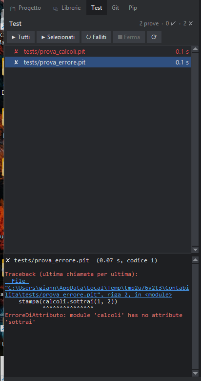

# I test del progetto

Il pannello **Test** (la linguetta «Test» a sinistra) trova da solo i programmi di prova del progetto, li esegue uno dopo l'altro e mostra per ciascuno se è andato bene.



## Quali file sono test

- i file che si chiamano `test_qualcosa`, `prova_qualcosa` o `qualcosa_test` (`.pit` oppure `.py`);
- tutti i file nelle cartelle `tests`, `test` e `prove` (quelli che iniziano con `_` o con «schermata» no).

Un test è un normale programma: **riesce** se finisce senza errori (codice di uscita 0) e **fallisce** se sbaglia o se un'istruzione di controllo lancia un'eccezione. Per fare un controllo scrivi per esempio:

```
importa calcoli
se calcoli.somma(2, 3) != 5:
    solleva Exception("la somma è sbagliata")
stampa("somma ok")
```

I test girano nella cartella del progetto e vedono i moduli del progetto (`importa calcoli` funziona anche se il test sta in `tests/`) e i pacchetti installati in `.pacchetti`.

## I pulsanti

| Pulsante | Cosa fa |
|---|---|
| **▶ Tutti** | esegue tutte le prove |
| **▶ Selezionati** | esegue solo quelle scelte nell'elenco (Ctrl+clic per sceglierne più d'una) |
| **↻ Falliti** | rifà solo quelle che non sono riuscite |
| **■ Ferma** | interrompe la prova in corso e le seguenti |
| **⟳** | cerca di nuovo i file di prova |

Accanto a ogni test: ✔ riuscito, ✘ fallito, ⏱ scaduto (supera il tempo massimo, 120 secondi; si cambia con l'impostazione `test.tempo_massimo`), ▶ in corso. In alto a destra il riassunto: «12 prove · 11 ✔ · 1 ✘».

Un clic su un test mostra in basso **tutto quello che ha scritto**, con gli errori in rosso. Le righe `File "…", riga N` sono link: un clic apre il file alla riga giusta. Un doppio clic sul test apre il suo file.
